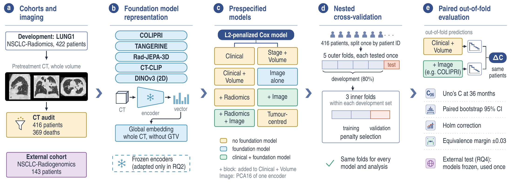
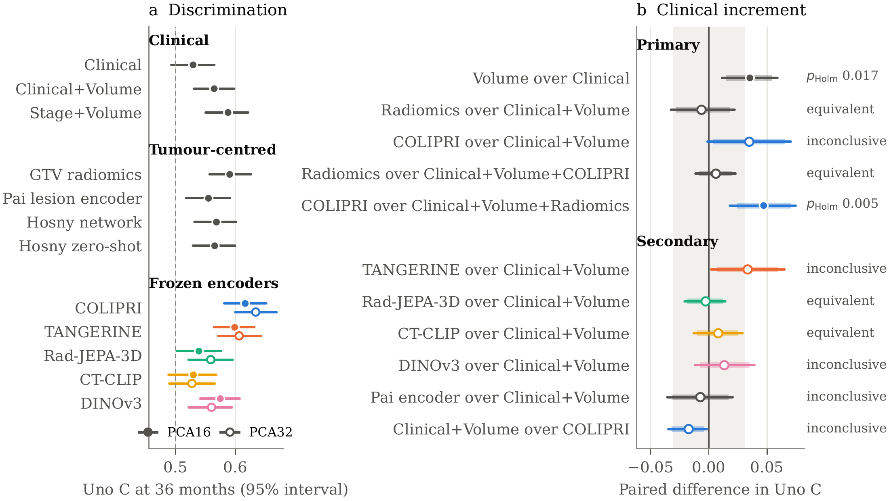

# CT foundation model prognostic transferability

Research code for **Prognostic transferability of CT foundation models in non-small-cell lung cancer: adaptation, tumour dependence, incremental clinical value and external evaluation**.

[Manuscript](manuscript/main.tex) · [Results](docs/results/README.md) · [Protocols](docs/README.md) · [Code guide](scripts/README.md)

The study compares COLIPRI, TANGERINE, Rad-JEPA-3D, CT-CLIP and DINOv3 for overall-survival prediction on **LUNG1**, with external evaluation on **NSCLC-Radiogenomics**. Analyses cover frozen representations, survival-specific adaptation, training-set size, tumour masking and incremental value beyond clinical and radiomic predictors. The manuscript is a working draft; see its verification record for outstanding issues.

## Study design



**Figure 1.** LUNG1 development cohort (416 patients), five foundation models, clinical and tumour-centred comparators, shared nested cross-validation, and external evaluation on NSCLC-Radiogenomics (143 patients). [Vector PDF](manuscript/figures/study_overview.pdf) · [Full caption](manuscript/figures/study_overview.tex).

## Main results

Uno's concordance at 36 months. Internal values are mean-fold estimates; external intervals are 95% bootstrap intervals conditional on the frozen models. Primary frozen encoders use PCA16 and a regularized Cox head.

| Model | LUNG1 | External (95% interval) |
| --- | ---: | ---: |
| COLIPRI | 0.617 | 0.627 (0.540–0.719) |
| TANGERINE | 0.599 | 0.649 (0.550–0.741) |
| DINOv3 | 0.575 | 0.643 (0.556–0.730) |
| Rad-JEPA-3D | 0.539 | 0.530 (0.436–0.627) |
| CT-CLIP | 0.530 | 0.482 (0.388–0.581) |
| Stage + tumour volume | 0.588 | 0.605 (0.508–0.702) |
| GTV radiomics | 0.591 | 0.617 (0.508–0.723) |
| Clinical + tumour volume | 0.565 | 0.646 (0.547–0.749) |

- **Frozen representations:** COLIPRI ranked highest internally, but no encoder significantly outperformed stage plus volume or radiomics after Holm correction.
- **Adaptation:** trainable heads and encoder adaptation did not improve internal discrimination over the frozen linear head; encoders showed no advantage in label efficiency.
- **Tumour dependence:** hiding the tumour changed discrimination by at most 0.013, despite a marked change in COLIPRI's representation.
- **External evaluation:** discrimination transported for the stronger encoders, but absolute risks were miscalibrated. Predicted 36-month mortality ranged from 37% to 85%, versus 25% observed.

These results do not establish equivalence where comparisons were inconclusive. Exploratory external LoRA results are separate from the frozen benchmark. See the [result gallery and aggregate CSV](docs/results/README.md) for all four research questions, uncertainty and provenance.



## Repository guide

| Location | Contents |
| --- | --- |
| [`manuscript/`](manuscript/README.md) | LaTeX manuscript, bibliography, figures, tables and artifact generators |
| [`scripts/`](scripts/README.md) | Cohort preparation, model extraction, survival experiments and analysis |
| [`docs/`](docs/README.md) | Protocols, audits and experiment reports |
| [`docs/planning/`](docs/planning/) | Research proposal and experiment progress record |
| [`configs/lung1_e1_folds.csv`](configs/lung1_e1_folds.csv) | Locked patient fold assignments |
| [`tests/`](tests/) | Survival metrics, Cox fitting and adaptation component checks |
| [`third_party/ctclip/`](third_party/ctclip/README.md) | Documented CT-CLIP compatibility code |

`data/`, `external/`, `outputs/`, `logs/`, `wandb/` and virtual environments are local, ignored directories. They contain datasets, downloaded model code/weights, derived features and run artifacts, and are not included in a fresh clone. Existing analysis output paths are retained for reproducibility.

## Environment

Run commands from the repository root. The full encoder stack targets Linux with CUDA; Rad-JEPA additionally needs the Mamba CUDA extensions.

```bash
python3 -m venv .venv
source .venv/bin/activate
python -m pip install -r requirements.txt
python -m pip install -r requirements-dev.txt
```

For the CUDA 12.1 installation workflow, see [`scripts/install_radjepa_cuda_deps.sh`](scripts/install_radjepa_cuda_deps.sh). Additional environments/dependencies are described in [`requirements-colipri.txt`](requirements-colipri.txt) and [`requirements-radiomics.txt`](requirements-radiomics.txt). COLIPRI and TANGERINE require different `timm` versions; follow the isolated dependency instructions in the COLIPRI requirements. DINOv3 setup is documented in the [encoder setup guide](docs/lung1_e2_setup_and_run.md).

## Reproduction workflow

1. Obtain the LUNG1 and NSCLC-Radiogenomics data and pretrained weights separately. Follow the [cohort audit](docs/lung1_cohort_audit.md), [preprocessing report](docs/lung1_foundation_models_training_preprocessing_results.md) and [external evaluation protocol](docs/lung1_phase4_protocol.md).
2. Prepare the cohorts and model inputs using the entry points in the [script guide](scripts/README.md). Review each script's arguments and input paths before launching it.
3. Extract embeddings and run the locked-fold analyses. The [documentation index](docs/README.md) distinguishes primary protocols, sensitivity analyses and exploratory reports.
4. Generate tables/figures and build the manuscript once the required local outputs are available.

A clone alone cannot reproduce the experiments without the datasets, external encoder repositories and checkpoints. The locations expected by the loaders are defined in `scripts/extract_lung1_e1_embeddings.py`. Historical run reports retain their original provenance and do not establish a prospective analysis plan.

## Checks and manuscript

```bash
.venv/bin/python -m pytest tests -q
make -C manuscript
```

`make -C manuscript` regenerates artifacts from local experiment outputs and compiles the paper. To compile only the checked-in tables and figures, use `make -C manuscript pdf`; this requires pdfLaTeX, BibTeX and the Vancouver bibliography style. Override the artifact-generation interpreter with `make -C manuscript PYTHON=/path/to/python`.

The compiled PDF is `manuscript/build/main.pdf`; generated LaTeX build files are ignored by Git. See the [manuscript guide](manuscript/README.md) for provenance and verification notes.
