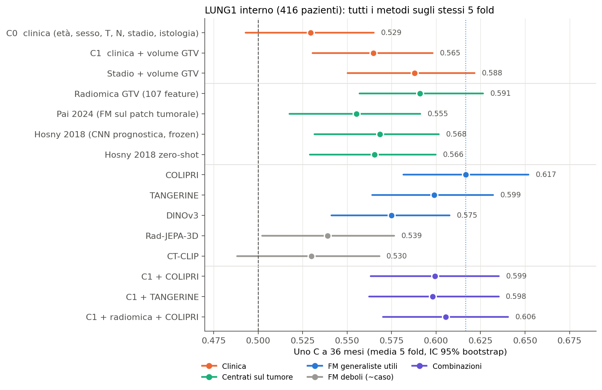
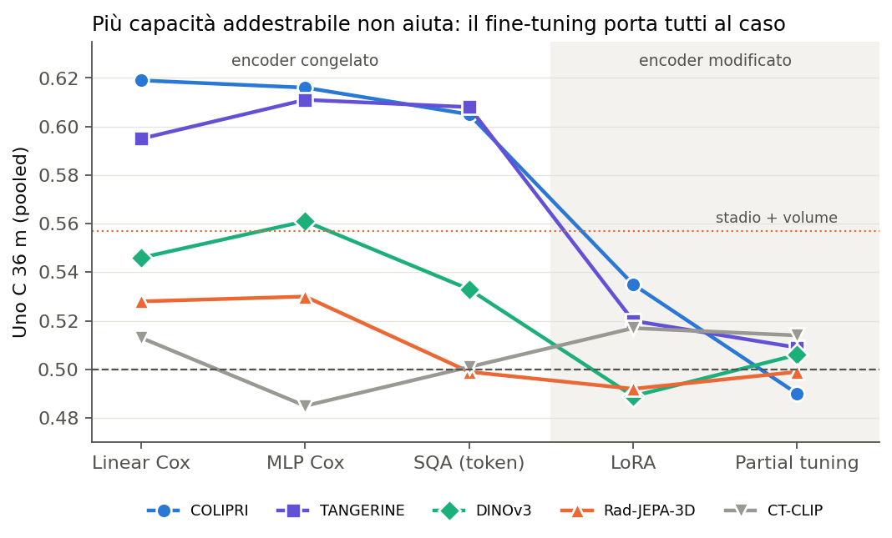
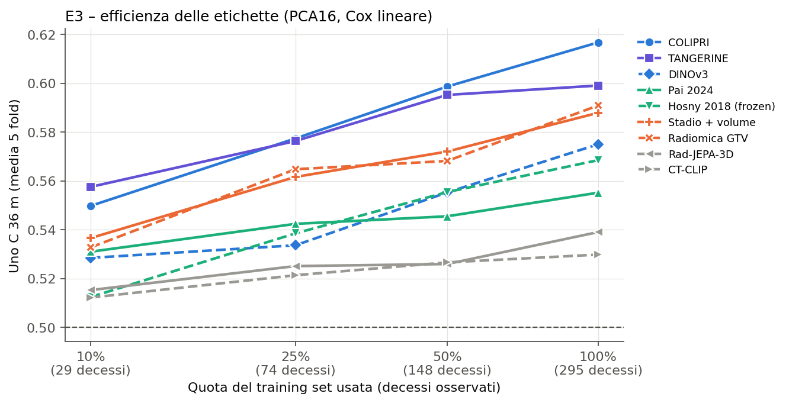
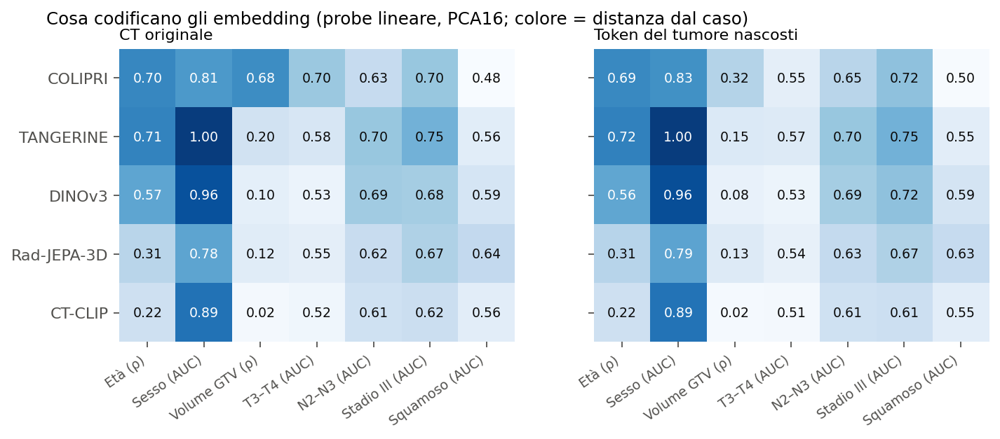
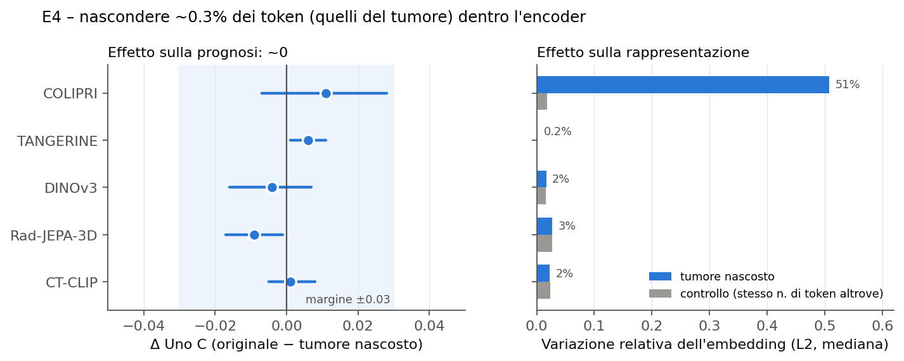
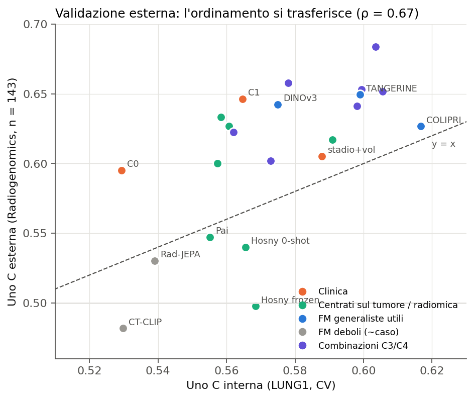
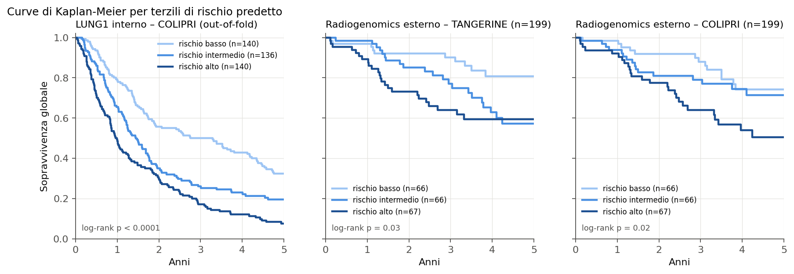

# Foundation model CT e prognosi nel NSCLC: sintesi di tutti gli esperimenti

**Data:** 26 ottobre 2026 (aggiornamento della sintesi del 21 ottobre)
**Scopo:** fare il punto su tutto il lavoro con le foundation model (FM) e fissare le conclusioni per il paper.
**Fonti:** i report in `docs/` (elencati alla fine) e i file in `outputs/`. I valori della Fase 3 sono letti direttamente dai `summary.json` completati (`mean_fold.uno_c_36m`); gli altri numeri restano quelli dei report precedenti. Questo aggiornamento non ricalcola intervalli di confidenza o test statistici.
**Figure:** `docs/figures/fm_sintesi/`, generate da `scripts/make_lung1_fm_summary_figures.py`. Le figure esistenti non sono state rigenerate: la figura 2 riguarda solo il precedente protocollo selected e non include lo sweep Fase 3.

---

## 0. In breve

1. **Le rappresentazioni congelate migliori raggiungono C ≈ 0.60–0.62 su LUNG1.** COLIPRI (0.617) e TANGERINE (0.599) costituiscono riferimenti utili; non sono un tetto di prestazione per tutti i protocolli.
2. **Il valore aggiunto rispetto alla clinica resta non dimostrato.** Il confronto frozen COLIPRI vs stadio + volume GTV (0.588) vale circa +0.03, con incertezza che non permette di stabilire superiorità o equivalenza.
3. **L'adattamento dipende fortemente dal protocollo.** Il precedente selected dava risultati prossimi al caso; nella Fase 3 completata, LoRA a LR 1e-3 e 20 epoche raggiunge 0.6393 per COLIPRI e 0.6301 per TANGERINE. Partial a LR 1e-4 e 20 epoche raggiunge rispettivamente 0.6005 e 0.6289. Sono osservazioni dello sweep, non prove confermative di superiorità del massimo selezionato sui test.
4. **Le prestazioni sono poco sensibili alle perturbazioni tumorali considerate.** Il probing mostra informazioni cliniche decodificabili dagli embedding, ma non identifica causalmente quali informazioni determinino la prognosi.
5. **I metodi centrati sul tumore non mostrano un vantaggio robusto nei confronti eseguiti.** Radiomica, Pai e Hosny raggiungono circa 0.55–0.59 internamente; capacità del probe, accesso alla segmentazione e limiti di riproduzione vanno dichiarati.
6. **La valutazione esterna frozen mostra discriminazione trasferibile per alcuni modelli, ma problemi di calibrazione.** Il guadagno sopra la clinica resta incerto. La successiva estensione esterna LoRA non è ancora disponibile.

**Messaggio per il paper:** alcune FM contengono informazione prognostica trasferibile nel NSCLC. Le prestazioni dell'adattamento dipendono dal protocollo di training; il valore incrementale rispetto alle covariate cliniche e il trasferimento del rischio assoluto rimangono da dimostrare.

---

## 1. Cosa abbiamo fatto

### 1.1 Domanda

Partendo da una TC pre-trattamento, quanta informazione sulla **sopravvivenza globale (OS)** di pazienti con NSCLC si può estrarre con tre famiglie di approcci?

- **FM CT su TC intera:** COLIPRI, TANGERINE, CT-CLIP, Rad-JEPA-3D.
- **FM generica:** DINOv3, addestrato su immagini naturali, usato come riferimento non medico.
- **Approcci "tailored" sul tumore:** radiomica sulla GTV, Pai 2024 (FM sul patch tumorale), Hosny 2018 (CNN prognostica supervisionata).

Abbiamo confrontato tutto con le **covariate cliniche**, poi abbiamo verificato **cosa codificano** gli embedding e **se i risultati si trasferiscono** a una coorte esterna.

### 1.2 Dati

| | LUNG1 (sviluppo) | NSCLC-Radiogenomics (esterna) |
| --- | --- | --- |
| Pazienti | 416 (dopo audit; 369 decessi) | 143 con segmentazione (primaria), 199 in totale (secondaria) |
| Decessi entro 36 mesi | 286 | 33 (primaria), 41 (secondaria) |
| Trattamento / stadio | radioterapia, soprattutto stadio III | chirurgia, 80% N0, soprattutto T1–T2 |
| TC tipica | 3 mm | 1–1.25 mm, spesso kernel "sharp" |

Le due coorti sono molto diverse. La validazione esterna è quindi un test di **trasferibilità sotto forte cambiamento di popolazione**, non una semplice replica.

### 1.3 Modelli

| Modello | Tipo | Pre-training | Input | Vettore |
| --- | --- | --- | --- | ---: |
| **COLIPRI** | FM CT 3D | multimodale / multi-obiettivo | TC intera, 2 mm, 192³ | 768 |
| **TANGERINE** | FM CT 3D | masked autoencoder | TC intera, 256³ | 2048 |
| **CT-CLIP** | FM CT 3D | contrastivo immagine–referto | TC intera, 240×480×480 | 512 |
| **Rad-JEPA-3D** | FM CT 3D | JEPA (Mamba ibrido) | TC intera, 32×256×256 | 384 |
| **DINOv3** | FM 2D generica | self-distillation su immagini naturali | fette assiali 224², media | 768 |
| **Pai 2024** | FM sul tumore | lesioni DeepLesion/LUNA16 | patch 50³ sul centroide GTV | 4096 |
| **Hosny 2018** | CNN prognostica | supervisionata (HarvardRT) | patch 50³ sul centroide GTV | 256 + score |
| **Radiomica** | feature classiche | — | GTV, 107 feature PyRadiomics | 107 |

**Asimmetria da dichiarare nel paper:** radiomica, Pai e Hosny usano la posizione e/o la segmentazione del tumore. Le FM sulla TC intera non le usano. Questo favorisce i metodi tumorali, eppure restano sotto.

### 1.4 Come misuriamo

- **Metrica principale:** C di Uno a 36 mesi, cioè la probabilità che, presi due pazienti, il modello assegni più rischio a quello che muore prima. 0.5 è il caso e 1 è la perfezione. Su LUNG1 la letteratura riporta circa 0.58–0.65.
- **Split:** 5 fold esterni bloccati, uguali per tutti i modelli. La penalità è scelta con una CV interna a 3 fold. I modelli congelati usano un **Cox lineare su PCA a 16 componenti**.
- **Statistica:** bootstrap appaiato sui pazienti e correzione di Holm dentro ogni famiglia di confronti. Per l'equivalenza usiamo il TOST con margine ±0.03.
- **Protocolli da distinguere nel paper:**
  - *primario*: media dei 5 fold, PCA16, inner CV (fasi 1, 2, 4, E3, E4);
  - *sensitivity "selected"*: train/val/test con predizioni pooled e PCA32. Serve per il confronto fra metodi di adattamento (E1/E2). I numeri dei due protocolli non vanno mescolati.
  - *Fase 3*: sweep BF16 su COLIPRI/TANGERINE, 24 configurazioni × 5 fold; train + validation esterni uniti (~332 pazienti), epoche fisse, valutazione finale senza selezione del checkpoint. La metrica qui riportata è la media dei fold.
  - *estensione E3/E5 LoRA*: analisi esplorativa scelta dopo aver esaminato la Fase 3 e la coorte esterna; esecuzione V100 in FP16, separata dai risultati BF16.

### 1.5 Esperimenti

| Blocco | Domanda | Report |
| --- | --- | --- |
| E1/E2 | Quanto segnale c'è nelle FM? Adattarle aiuta? (linear, MLP, SQA, LoRA, partial) | `lung1_foundation_models_training_preprocessing_results.md` |
| E3 | Quante etichette servono? (10–100% del training) | `lung1_e3_frozen_linear_report.md`, `lung1_e3_matched_baselines_report.md` |
| E4 | Il segnale viene dal tumore? (pooling regionale, riempimento del GTV, token mascherati) | `lung1_e4_regional_frozen_cox_report.md`, `lung1_e4_token_masking_report.md` |
| Fase 1 | Tetto empirico, potenza, probing delle variabili cliniche | `docs/planning/experiment_progress.txt`, `lung1_phase1_protocol.md` |
| Fase 2 | Metodi centrati sul tumore (Pai, Hosny) | `lung1_phase2_tumour_centred_report.md` |
| Fase 3 | Sensibilità a learning rate ed epoche di LoRA/partial; completata | `lung1_phase3_protocol.md`, `outputs/lung1_phase3/` |
| E3/E5 LoRA | Efficienza delle etichette e trasferimento esterno dopo adattamento; incompleta | `lung1_e3_e5_lora_protocol.md` |
| Fase 4 | Validazione esterna su Radiogenomics | `lung1_phase4_external_validation_report.md` |

---

## 2. Risultati

### 2.1 Quanto è prognostico ogni approccio (LUNG1, protocollo primario)

| Gruppo | Modello | Uno C 36 m [IC 95%] |
| --- | --- | --- |
| Clinica | C0: età, sesso, T, N, stadio, istologia | 0.529 [0.493, 0.565] |
| | C1: C0 + volume GTV | 0.565 [0.531, 0.598] |
| | Stadio + volume GTV | 0.588 [0.550, 0.622] |
| Tumore | Radiomica GTV | 0.591 [0.557, 0.626] |
| | Pai 2024 | 0.555 [0.518, 0.591] |
| | Hosny 2018 zero-shot | 0.566 [0.529, 0.600] |
| FM su TC intera | **COLIPRI** | **0.617 [0.582, 0.652]** |
| | TANGERINE | 0.599 [0.564, 0.632] |
| | DINOv3 | 0.575 [0.541, 0.608] |
| | Rad-JEPA-3D | 0.539 [0.502, 0.577] |
| | CT-CLIP | 0.530 [0.488, 0.568] |
| Combinazioni | C1 + COLIPRI (C3) | 0.599 [0.563, 0.635] |
| | C1 + radiomica + COLIPRI (C4) | 0.606 [0.570, 0.640] |

**Come leggerla:**
- Le FM si dividono in **due gruppi netti**. COLIPRI e TANGERINE sono sempre indistinguibili tra loro e sono sopra CT-CLIP e Rad-JEPA in quasi tutti i confronti (Holm p < 0.01). DINOv3, nonostante sia addestrato su foto, sta in mezzo.
- **Nessuna combinazione supera COLIPRI da solo.** Aggiungere la clinica a COLIPRI lo peggiora leggermente (−0.017). La clinica "rumorosa" (età, sesso, istologia) aggiunge varianza e non segnale.
- **Attenzione alla baseline:** C1 (0.565) è più debole di stadio + volume (0.588). Il confronto "FM sopra la clinica" va fatto contro stadio + volume, altrimenti il guadagno delle FM appare gonfiato.

### 2.2 Adattamento: risultati selected e sensibilità al protocollo

#### Risultati del precedente protocollo selected

*Protocollo "selected" (pooled, PCA32): i valori sono un po' diversi dal 2.1 e non vanno confrontati direttamente con quelli.*

| | Linear | MLP | SQA (token) | LoRA | Partial |
| --- | ---: | ---: | ---: | ---: | ---: |
| COLIPRI | **0.619** | 0.616 | 0.605 | 0.535 | 0.490 |
| TANGERINE | 0.595 | 0.611 | 0.608 | 0.520 | 0.509 |
| DINOv3 | 0.546 | 0.561 | 0.533 | 0.489 | 0.506 |
| Rad-JEPA-3D | 0.528 | 0.530 | 0.499 | 0.492 | 0.499 |
| CT-CLIP | 0.513 | 0.485 | 0.501 | 0.517 | 0.514 |

- **Non emerge un miglioramento significativo di MLP e SQA** rispetto al Cox lineare nel protocollo selected (tutti pHolm = 1).
- **Nel protocollo selected, LoRA e partial fine-tuning danno valori prossimi al caso**. Per COLIPRI e TANGERINE il calo rispetto al lineare è significativo (−0.08 / −0.13, pHolm ≤ 0.003).
- Lo stesso succede a **Hosny**: il fine-tuning su LUNG1 fa peggio del suo zero-shot (0.531 vs 0.569). L'epoca scelta sulla validazione (circa 80 pazienti) non si trasferisce al test: nel fold 4 il C è 0.640 in validazione e 0.482 in test.
- **Lettura aggiornata:** questi risultati descrivono il protocollo selected. Campione, ottimizzazione e selezione del checkpoint sono possibili spiegazioni, ma non sono stati isolati causalmente. La Fase 3 esclude una conclusione generale di fallimento dell’adattamento.

#### Fase 3 completata: tutte le 24 configurazioni

Completata il **23 ottobre 2026 alle 03:48, ora italiana**, con marcatore `outputs/lung1_phase3/COMPLETE`, 24 riepiloghi e 120 fold completati. Il protocollo è stato dichiarato il 21 ottobre prima dello sweep. Ogni configurazione parte dai pesi preaddestrati e usa cinque fold bloccati, BF16, loss Cox Efron e valutazione dell'ultima epoca. Non si sceglie un checkpoint sulla validation.

| Metodo | Learning rate | Epoche | COLIPRI, Uno C 36 m | TANGERINE, Uno C 36 m |
| --- | --- | ---: | ---: | ---: |
| lora | 1e-5 | 5 | 0.5069 | 0.5238 |
| lora | 1e-5 | 20 | 0.5124 | 0.5285 |
| lora | 1e-4 | 5 | 0.5224 | 0.5420 |
| lora | 1e-4 | 20 | 0.5721 | 0.5680 |
| lora | 1e-3 | 5 | 0.6081 | 0.5715 |
| lora | 1e-3 | 20 | 0.6393 | 0.6301 |
| partial | 1e-6 | 5 | 0.4852 | 0.5098 |
| partial | 1e-6 | 20 | 0.4864 | 0.5163 |
| partial | 1e-5 | 5 | 0.4885 | 0.5207 |
| partial | 1e-5 | 20 | 0.5004 | 0.5642 |
| partial | 1e-4 | 5 | 0.5266 | 0.5787 |
| partial | 1e-4 | 20 | 0.6005 | 0.6289 |

**Provenienza:** `outputs/lung1_phase3/lr{LR}_ep{EPOCHS}/{method}/{model}/summary.json`, campo `mean_fold.uno_c_36m`; ogni valore è una media di cinque fold. La tabella comprende 12 impostazioni per due modelli, quindi 24 configurazioni.

**Interpretazione:** all'interno dello sweep, le stime puntuali aumentano con learning rate ed epoche nei valori esplorati. LoRA 1e-3/20 epoche supera numericamente i riferimenti frozen PCA16 (0.617 e 0.599), ma non è stata eseguita qui una nuova inferenza appaiata. Non si può presentare il massimo dei test come performance non distorta di un metodo selezionato. Il confronto con selected cambia anche numerosità di training e regola del checkpoint: non attribuisce il recupero a un solo fattore. La conclusione supportata è che il fallimento osservato nel protocollo iniziale non si generalizza a tutti i protocolli di adattamento.

#### Estensione E3/E5 LoRA: stato e limiti

Al controllo del 26 ottobre, E3 su V100/FP16 non ha un marcatore `COMPLETE` e lo stato della coda riporta `RUNNING e3`; la directory dei risultati E5 V100 non è ancora presente. Non si riportano risultati aggregati finali per queste analisi. La configurazione LR 1e-3/20 epoche è stata scelta dopo aver osservato la Fase 3: curve di apprendimento e valutazione esterna successive sono **esplorative**, non nuove conferme indipendenti. La coorte esterna era già stata esaminata nella Fase 4. I risultati FP16 devono rimanere distinti da quelli BF16.

### 2.3 Quante etichette servono (E3 frozen)

| Modello (PCA16) | 10% (29 decessi) | 25% | 50% | 100% (295 decessi) |
| --- | ---: | ---: | ---: | ---: |
| COLIPRI | 0.550 | 0.577 | 0.599 | **0.617** |
| TANGERINE | **0.558** | 0.576 | 0.595 | 0.599 |
| Stadio + volume | 0.537 | 0.562 | 0.572 | 0.588 |
| Radiomica | 0.533 | 0.565 | 0.568 | 0.591 |
| DINOv3 | 0.528 | 0.534 | 0.555 | 0.575 |
| Hosny (frozen) | 0.512 | 0.539 | 0.555 | 0.568 |
| Pai | 0.531 | 0.542 | 0.545 | 0.555 |
| Rad-JEPA-3D | 0.515 | 0.525 | 0.526 | 0.539 |
| CT-CLIP | 0.512 | 0.521 | 0.527 | 0.530 |

- COLIPRI e TANGERINE stanno **sopra le baseline a ogni budget**, ma le differenze non sono mai significative (primaria 100%: COLIPRI − stadio + volume = +0.029 [−0.015, +0.071], pHolm = 1).
- Le curve **non sono sature**: COLIPRI cresce ancora tra il 50% e il 100%, quindi più pazienti potrebbero aiutare.
- **Dipendenza dalla PCA:** con PCA8, COLIPRI scende a 0.584 e Pai sale a 0.583, alla pari. Nel paper va scritto che "a capacità pari, Pai è al massimo alla pari di COLIPRI, mai meglio", non che "Pai è nettamente peggiore".

### 2.4 Le FM aggiungono qualcosa alla clinica? (scala del tetto, Fase 1)

| Contrasto | Δ Uno C [IC 95%] | Esito |
| --- | --- | --- |
| C1 − C0 (il volume aggiunge alla clinica) | +0.035 [+0.011, +0.059] | **significativo** (pHolm 0.017) |
| C2 − C1 (la radiomica aggiunge a C1) | −0.006 | **equivalente** entro ±0.03: non aggiunge |
| C3-COLIPRI − C1 (la FM aggiunge a C1) | +0.035 [−0.001, +0.070] | **non conclusivo** (pHolm 0.19) |
| C3-TANGERINE − C1 | +0.033 [+0.002, +0.065] | non conclusivo (pHolm 0.24) |
| C3-Rad-JEPA / C3-CT-CLIP − C1 | −0.003 / +0.008 | equivalenti: non aggiungono |
| C4 − C3 (il tumore aggiunge alla FM) | +0.006 | **equivalente**: radiomica e FM ridondanti |
| Stadio + vol + COLIPRI − stadio + vol | +0.033 [−0.010, +0.069] | non significativo (pHolm 0.38) |
| Stadio + vol + COLIPRI − COLIPRI | +0.003 | COLIPRI contiene già il rischio clinico |

**Potenza:** con 416 pazienti, la differenza minima rilevabile (80% di potenza) è **0.025–0.056**, circa 0.05 per "FM sopra C1". I guadagni osservati (circa +0.03) sono sotto questa soglia. Non possiamo dimostrare né superiorità né equivalenza: è un limite di campione, non un risultato negativo.

### 2.5 Da dove viene il segnale

#### Cosa codificano gli embedding (probing)

Un probe lineare predice le variabili cliniche dall'embedding:
- **Sesso:** quasi perfetto per tutti (AUC 0.78–1.00). Gli embedding codificano l'anatomia.
- **Età:** ben codificata da COLIPRI (ρ 0.70) e TANGERINE (0.71), meno da DINOv3 (0.57), poco da CT-CLIP e Rad-JEPA (0.22–0.31). **Le due FM prognostiche sono quelle che codificano meglio l'età.**
- **Linfonodi (N2–N3) e stadio III:** AUC 0.61–0.75, **invariati quando si nasconde il tumore**. L'informazione sta fuori dal GTV primario, come ci si aspetta per i linfonodi.
- **Volume tumorale:** solo COLIPRI lo codifica davvero (ρ 0.68). Nascondendo il tumore scende a 0.32 (T3–T4: da 0.70 a 0.55). Le altre FM lo codificano poco (ρ ≤ 0.20).
- **Istologia:** al caso per tutti.

#### Interventi sul tumore (E4)

Abbiamo provato a togliere il tumore in tre modi, dal più grezzo al più pulito:

| Intervento | Cosa fa | Risultato |
| --- | --- | --- |
| **Pooling regionale** | media solo dei token sopra il tumore, attorno, o fuori | Per COLIPRI e TANGERINE la regione cambia poco (±0.01). Il token "tumore" non è più prognostico della media globale. |
| **Riempimento del GTV** nell'input (mediana, inpainting, nero) + controllo della stessa forma altrove | modifica i voxel prima dell'encoder | Solo COLIPRI reagisce: −0.018 con la mediana e −0.023 con il nero, ma solo −0.003 con l'inpainting. **Dipende da come si riempie**, quindi non è una prova. |
| **Token del tumore nascosti dentro l'encoder** (attention mask in ogni layer) + controllo con lo stesso numero di token | nessun token può "guardare" il tumore | Δ C entro ±0.015 per tutti e 5 i modelli. Senza rifit (Cox addestrato sull'originale e applicato al mascherato): COLIPRI +0.013 [−0.002, +0.030], gli altri entro ±0.005. |

**Il risultato più interessante:** nascondere lo 0.3% dei token (quelli del tumore) **sposta l'embedding di COLIPRI del 51%**. Nascondere lo stesso numero di token altrove lo sposta del 2%. COLIPRI quindi "guarda" molto il tumore, eppure **la sua capacità prognostica non cambia**. La rappresentazione è sensibile alla perturbazione tumorale, mentre la discriminazione prognostica rimane simile. Questo non dimostra che il tumore sia privo di informazione prognostica o che il predittore non la utilizzi.

### 2.6 Metodi centrati sul tumore (Fase 2)

- **Pai 2024** (0.555) e **Hosny 2018** (frozen 0.568, zero-shot 0.566) sono **indistinguibili da stadio + volume e dalla radiomica** (tutti pHolm ≥ 0.67), e aggiunti a C1 non aggiungono nulla. Lo score di Hosny è equivalente a C1 entro ±0.03.
- Contro COLIPRI, tutti i contrasti "tumore vs TC intera" sono **−0.04 / −0.06**, con IC 95% sotto zero. Dopo Holm restano significativi nel protocollo selected (p 0.001–0.04), con p 0.06–0.14 nel primario.
- **Hosny è una reimplementazione:** abbiamo portato i pesi in PyTorch con riproduzione esatta sui 3 esempi degli autori. Sui pazienti Maastro la correlazione con le loro predizioni pubblicate è però 0.765, sotto la soglia prefissata di 0.9. La differenza sta negli array di input degli autori (AUC a 2 anni 0.667 nostro vs 0.695 pubblicato, differenza n.s.). La deviazione va dichiarata.

### 2.7 Validazione esterna (Fase 4, NSCLC-Radiogenomics)

22 modelli sono stati riaddestrati su tutto LUNG1, **congelati con hash** e applicati **una sola volta** alla coorte esterna, secondo un protocollo scritto prima di vedere le immagini.

| Modello | C esterna (n=143) [IC 95%] | C esterna (n=199) | C interna |
| --- | --- | --- | --- |
| C4-TANGERINE (C1 + radiomica + TANGERINE) | 0.684 [0.588, 0.776] | — | 0.604 |
| TANGERINE | 0.649 [0.550, 0.741] | **0.662** (pHolm 0.0007) | 0.599 |
| C1 (clinica + volume) | 0.646 [0.547, 0.749] | — | 0.565 |
| DINOv3 | 0.643 [0.556, 0.730] | **0.660** (pHolm 0.0004) | 0.575 |
| COLIPRI | 0.627 [0.540, 0.719] | **0.641** (pHolm 0.003) | 0.617 |
| Stadio + volume | 0.605 [0.508, 0.702] | — | 0.588 |
| Pai | 0.547 [0.446, 0.646] | — | 0.555 |
| Hosny zero-shot | 0.540 [0.432, 0.643] | — | 0.566 |
| Rad-JEPA-3D | 0.530 [0.436, 0.627] | 0.479 | 0.539 |
| CT-CLIP | 0.482 [0.388, 0.581] | 0.512 | 0.530 |

*Le KM sono descrittive. I terzili sono calcolati dentro ogni fold di test (LUNG1) e sulla distribuzione del rischio nella coorte esterna (Radiogenomics), non con soglie fissate su LUNG1.*

**Contrasti primari dichiarati nel protocollo** (nessuno significativo, come previsto dall'analisi di potenza, con differenza minima rilevabile 0.09–0.20):

| Contrasto | Δ [IC 95%] | pHolm |
| --- | --- | --- |
| COLIPRI − stadio + volume | +0.021 [−0.068, +0.126] | 1.00 |
| C3-COLIPRI − C1 | +0.007 [−0.052, +0.071] | 1.00 |
| COLIPRI − Pai | +0.080 [−0.031, +0.195] | 0.67 |
| COLIPRI − Hosny zero-shot | +0.087 [−0.046, +0.231] | 0.67 |

**Cosa si trasferisce e cosa no:**
- ✅ **L'ordinamento si trasferisce:** Spearman tra C interna ed esterna = 0.67 (p = 0.0006, 22 modelli). Le FM utili restano utili e quelle al caso restano al caso.
- ✅ **Le FM generaliste trasferiscono**, quelle centrate sul tumore no: Hosny frozen scende da 0.568 a 0.498.
- ⚠️ **La clinica migliora molto all'esterno** (C1: da 0.565 a 0.646). In pazienti chirurgici in stadio precoce, età, T e N separano il rischio meglio che in uno stadio III omogeneo. "FM sopra la clinica" resta quindi non dimostrato (+0.007).
- ⚠️ **"Il miglior FM" non si trasferisce:** COLIPRI, primo internamente, viene superato da TANGERINE e DINOv3 (di circa 0.02, dentro il rumore). L'affermazione robusta riguarda il *gruppo* di FM generaliste buone, non un singolo modello.
- ❌ **La calibrazione non si trasferisce:** il rapporto O/E a 36 mesi è circa 0.4 (rischio predetto 60–85% contro 25% osservato) e la calibration slope va da 0.5 a 3. I rischi assoluti stimati su LUNG1 non si possono usare senza ricalibrazione.

---

## 3. Conclusioni per il paper

### 3.1 Cosa possiamo affermare

| Affermazione | Evidenza | Forza |
| --- | --- | --- |
| Alcune FM CT generaliste congelate contengono segnale prognostico sopra il caso | COLIPRI/TANGERINE pHolm < 0.001 internamente; TANGERINE/DINOv3/COLIPRI pHolm ≤ 0.003 esternamente | **forte** |
| Le pipeline frozen differiscono nelle prestazioni; il contributo specifico del pre-training non è isolato | COLIPRI/TANGERINE vs CT-CLIP/Rad-JEPA: +0.07/+0.13, pHolm < 0.01; stesso ordine all'esterno | **forte** |
| Il risultato dell’adattamento dipende dal protocollo | Selected prossimo al caso; Fase 3 LoRA fino a 0.6393/0.6301, partial fino a 0.6005/0.6289 | **descrittiva**; superiorità confermativa non stabilita |
| Le prestazioni variano poco sotto le perturbazioni tumorali considerate | token masking ≈ 0 per tutti i 5 modelli; no-rifit ≈ 0; probing linfonodi invariato | **buona** |
| Gli approcci centrati sul tumore (radiomica, Pai, Hosny) non battono le FM su TC intera, pur usando la segmentazione | −0.04/−0.06 vs COLIPRI internamente; al caso all'esterno | **buona** |
| L'ordinamento dei modelli si trasferisce a una coorte molto diversa | ρ = 0.67, p = 0.0006 | **buona** |
| Nei contrasti specificati, l’aggiunta della radiomica produce differenze entro il margine di equivalenza | C2 ≈ C1, C4 ≈ C3 (TOST, ±0.03); non dimostra equivalenza tra FM e clinica | **limitata ai contrasti valutati** |

### 3.2 Cosa NON possiamo affermare

| Affermazione | Perché no |
| --- | --- |
| "Le FM superano la clinica" | +0.03 internamente, +0.007 esternamente; mai significativo; potenza insufficiente |
| "Le FM sono equivalenti alla clinica" | Gli IC sono troppo larghi per dimostrare l'equivalenza entro ±0.03 |
| "COLIPRI è la migliore FM" | Internamente è indistinguibile da TANGERINE, ed esternamente viene superata |
| "Il tumore non contiene informazione prognostica" | Le perturbazioni mostrano limitata sensibilità della performance; non dimostrano assenza o mancato utilizzo dell’informazione tumorale |
| "I modelli sono pronti per l'uso clinico" | La calibrazione non si trasferisce; servono ricalibrazione e coorti più grandi |
| "Il fine-tuning non funziona mai" | La Fase 3 completata mostra prestazioni diverse dal precedente selected |
| "LoRA è superiore al frozen" | Il massimo è stato identificato sui test dello sweep; mancano una selezione indipendente e un confronto confermativo |
| "LoRA trasferisce meglio all’esterno" | E5 non è ancora disponibile e sarà comunque esplorativo |

### 3.3 Messaggio proposto

> Su due coorti pubbliche di NSCLC, alcune rappresentazioni congelate mostrano discriminazione prognostica trasferibile. Lo sweep di adattamento su LUNG1 mostra che prestazioni prossime al caso nel protocollo iniziale non costituiscono un limite generale di LoRA o del partial fine-tuning. Il valore aggiunto rispetto alla clinica rimane incerto; le perturbazioni tumorali considerate modificano poco la discriminazione, mentre la calibrazione del rischio assoluto presenta limiti nel trasferimento esterno. Servono valutazioni indipendenti per confermare i vantaggi delle configurazioni individuate nello sweep.

Non si propone un tetto universale di prestazione né una numerosità minima universale. Un futuro calcolo del campione deve specificare effetto atteso, eventi, censura e contrasto di interesse.

---

## 4. Limiti principali (da riportare)

1. **Potenza:** 416 pazienti interni (differenza minima rilevabile circa 0.05) e 33 eventi esterni (0.09–0.20). Molti confronti restano non conclusivi.
2. **Preprocessing diverso per modello:** ogni FM usa il suo input ufficiale (campo di vista, spacing, finestra HU). Le differenze tra FM non sono attribuibili solo al pre-training.
3. **Scelte post hoc dichiarate:** la PCA16 nasce come sensitivity in E3, e alcune famiglie di Holm sono state definite dopo i risultati. Le Fasi 1, 2 e 4 hanno invece protocolli scritti prima dei risultati.
4. **CT-CLIP:** il checkpoint viene da un mirror pubblico e l'identità con quello ufficiale non è verificata. LoRA/partial adattano solo la proiezione finale.
5. **Hosny:** check di riproduzione fallito (ρ 0.765 < 0.9), riportato come reimplementazione.
6. **Interventi E4:** nascondere token interi toglie anche tessuto peritumorale (molto per Rad-JEPA), e gli encoder non hanno mai visto questo tipo di mascheramento durante il pre-training.
7. **Adattamento e selezione:** Fase 3 modifica più elementi del protocollo selected; i massimi dello sweep sono informati dai test. E3/E5 LoRA sono esplorativi, con modifica numerica BF16 → FP16 e coorte esterna già osservata.
8. **Coorte esterna:** popolazione, trattamento, TNM (patologico vs clinico) e TC diversi. Pai e Hosny sono valutati solo sui 143 pazienti con segmentazione.

---

## 5. Cosa resta da fare

- [x] **Fase 3:** completata; tutte le 24 configurazioni riportate al §2.2 e narrativa sul fine-tuning aggiornata.
- [ ] **E3/E5 LoRA:** attendere il completamento, verificare risultati e provenienza, mantenere la qualifica esplorativa.
- [ ] **Figure:** aggiungere lo sweep completo e aggiornare didascalie e messaggi senza confondere selected e Fase 3.
- [ ] **ProtoSurv:** da includere solo se arriva il checkpoint.
- [ ] **Scrittura:** lavorare in `manuscript/`, in inglese e LaTeX/BibTeX, con struttura IMRaD e citazioni Vancouver. Organizzare i risultati per rappresentazioni frozen, adattamento/budget, perturbazioni e trasferimento esterno. Verificare letteratura e riferimenti originali; dichiarare cronologia delle scelte, differenze tra protocolli e asimmetria nell’accesso alla segmentazione. La rivista rimane da scegliere.

---

## Fonti

- Coorte: [lung1_cohort_audit.md](lung1_cohort_audit.md)
- E1/E2: [lung1_foundation_models_training_preprocessing_results.md](lung1_foundation_models_training_preprocessing_results.md), [lung1_bf16_selected_baselines_report.md](lung1_bf16_selected_baselines_report.md), [lung1_dinov3_bf16_selected_report.md](lung1_dinov3_bf16_selected_report.md)
- E3: [lung1_e3_frozen_linear_report.md](lung1_e3_frozen_linear_report.md), [lung1_e3_matched_baselines_report.md](lung1_e3_matched_baselines_report.md)
- E4: [lung1_e4_regional_frozen_cox_report.md](lung1_e4_regional_frozen_cox_report.md), [lung1_e4_token_masking_report.md](lung1_e4_token_masking_report.md), [lung1_dinov3_e3_e4_report.md](lung1_dinov3_e3_e4_report.md)
- Clinica + FM: [lung1_clinical_plus_fm_report.md](lung1_clinical_plus_fm_report.md)
- Fase 1: [lung1_phase1_protocol.md](lung1_phase1_protocol.md), risultati in `docs/planning/experiment_progress.txt` e `outputs/lung1_ceiling_ladder/`, `outputs/lung1_embedding_probing/`, `outputs/lung1_e4_no_refit/`
- Fase 2: [lung1_phase2_protocol.md](lung1_phase2_protocol.md), [lung1_phase2_tumour_centred_report.md](lung1_phase2_tumour_centred_report.md)
- Fase 4: [lung1_phase4_protocol.md](lung1_phase4_protocol.md), [lung1_phase4_external_validation_report.md](lung1_phase4_external_validation_report.md)

- Fase 3: [lung1_phase3_protocol.md](lung1_phase3_protocol.md), risultati in `outputs/lung1_phase3/` (24 `summary.json`, 120 fold; completamento 23 ottobre 2026).
- Estensione esplorativa E3/E5 LoRA: [lung1_e3_e5_lora_protocol.md](lung1_e3_e5_lora_protocol.md), output separati V100/FP16 in `outputs/lung1_e3_lora_v100_fp16/` e, quando disponibili, `outputs/lung1_e5_lora_v100_fp16/`.
