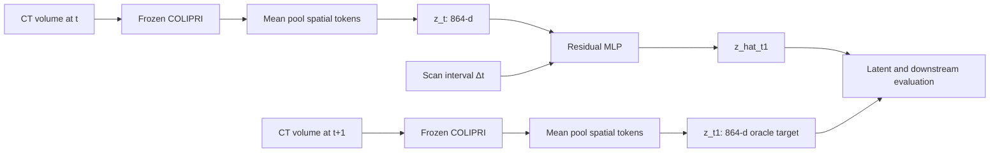
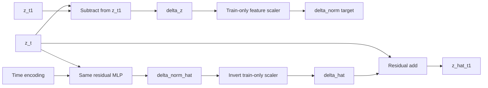

# COLIPRI latent world-model objective and time-conditioning ablation

## Executive summary

This experiment tested whether the first COLIPRI world-model limitation was
mainly caused by the raw-space transition objective or by the time
conditioning, while keeping COLIPRI frozen and keeping the residual MLP
architecture small.

The strongest result is a real improvement in latent forecasting. Predicting
a training-standardized delta reduces pooled test MSE and L2 distance below
the identity predictor:

| Representation | MSE ↓ | Cosine ↑ | L2 ↓ |
|---|---:|---:|---:|
| Identity `z_t` | 0.000965 | 0.975268 | 0.856266 |
| Previous raw residual MLP | 0.001114 | 0.977884 | 0.937976 |
| New standardized-delta, scalar time | 0.000887 ± 0.003 | 0.9769 | 0.8303 |
| New standardized-delta, Fourier time | **0.000884** | **0.9770** | **0.8278** |
| Oracle actual `z_t1` | 0 | 1 | 0 |

The validation-selected objective was **A: standardized-delta MSE**. Cosine and
residual-shrinkage additions did not produce a meaningful change in this
setting. Fourier time conditioning was marginally best for reconstruction, but
the differences between no-time, scalar, log, and Fourier conditioning were
very small.

The prognostic result is more modest. The new model improves over the prior
raw-residual predictor and over `z_t` at 1y, 2y, and 3y in AUROC/AUPRC, but
the gains are small and the actual observed future state remains far better at
1y and 2y. Therefore, objective/scaling was a real bottleneck for latent
reconstruction, but it is not the only bottleneck for future prognostic
information.

## 1. Experiment design

### Fixed components

- Frozen mean-pooled COLIPRI embedding, 864 dimensions.
- No COLIPRI fine-tuning.
- Same 1,984 longitudinal pairs as the first baseline:
  - 995 T0→T1 pairs
  - 989 T1→T2 pairs
- Same patient-level split: 599 train, 200 validation, 200 test patients.
- Same primary post-t+1 cancer endpoints at 1y, 2y, and 3y.
- Same simple linear prognostic/diagnostic probe and five probe seeds.
- Five independent world-model seeds; no seed averaging in the primary
  results.

### Current representation path

Each scan is converted to a frozen 864-d COLIPRI mean-pooled vector. The
transition model receives the current vector and scan interval and predicts a
residual for the next vector.



## 2. Architectural proposals tested

The architecture was intentionally unchanged apart from the time-input
encoding. The predictor still has two 1024-unit hidden layers, GELUs, and
dropout 0.1.

### Previous raw-residual baseline

```mermaid
flowchart LR
    Z[z_t 864] --> LN[LayerNorm]
    T[normalized Δt] --> TE[small time MLP]
    LN --> CAT[Concatenate]
    TE --> CAT
    CAT --> H1[Linear 1024 + GELU + Dropout]
    H1 --> H2[Linear 1024 + GELU + Dropout]
    H2 --> D[Linear 864: delta_hat]
    Z --> ADD[Residual add]
    D --> ADD
    ADD --> P[z_hat_t1]
    P --> L[raw MSE + cosine(z_hat_t1,z_t1)]
```

### New standardized-delta target

The target is the transition itself rather than the future representation:

```text
delta_z      = z_t1 - z_t
delta_norm   = (delta_z - mu_train) / std_train
delta_norm_hat = MLP(z_t, time)
delta_hat    = delta_norm_hat * std_train + mu_train
z_hat_t1     = z_t + delta_hat
```

The feature-wise `mu_train` and `std_train` are fitted using training pairs
only. They are then held fixed for validation and test reconstruction.



### Objective branches

```mermaid
flowchart TD
    P[z_hat_t1] --> COS[1 - cosine(z_hat_t1,z_t1)]
    DN[delta_norm_hat] --> DMSE[MSE(delta_norm_hat,delta_norm)]
    DH[delta_hat] --> SHR[mean squared residual]
    DMSE --> A[Objective A: DMSE]
    DMSE --> B[Objective B: DMSE + cosine]
    COS --> B
    DMSE --> C[Objective C: DMSE + cosine + beta residual penalty]
    COS --> C
    SHR --> C
    BETA[beta ∈ {0, 1e-4, 1e-3, 1e-2}] --> C
```

### Time-conditioning ablation

```mermaid
flowchart LR
    DT[Δt days] --> N[Train-only normalization]
    N --> S[Scalar]
    DT --> LOG[log(1+Δt)]
    LOG --> LN[Train-only normalization]
    LN --> L[Log scalar]
    N --> F[Small sin/cos Fourier features]
    S --> M[Same MLP]
    L --> M
    F --> M
    NONE[No time input] --> M
    M --> OUT[delta_norm_hat]
```

## 3. Objective selection

All objective variants used scalar normalized time for the first selection
stage. The objective was selected using mean validation latent MSE across the
five world-model seeds. Objective A was selected:

```text
L_A = MSE(delta_norm_hat, delta_norm)
```

Objective B added future-state cosine loss with lambda=1. Objective C added
the same cosine term and residual shrinkage with the requested beta grid.

The pooled test latent results for A/B/C were effectively indistinguishable
at the displayed precision. This indicates that the dominant improvement came
from scaling the delta target, not from adding the future-state cosine term or
the small residual penalty.

An important implementation interpretation is that the beta values are small
relative to the raw residual magnitude. The absence of a visible beta effect
does not prove that residual shrinkage is useless; it suggests that a future
shrinkage study should either normalize the residual penalty or select beta on
a log scale around the empirical residual variance.

## 4. Latent forecasting results

### Pooled test pairs

The table reports means over world-model seeds where applicable.

| Representation | MSE ↓ | Cosine ↑ | L2 ↓ | Delta MSE ↓ | Delta cosine ↑ |
|---|---:|---:|---:|---:|---:|
| Identity | 0.000965 | 0.975268 | 0.856266 | 0.000965 | 0.000 |
| Previous raw residual | 0.001114 | 0.977884 | 0.937976 | 0.001114 | not reported |
| A, scalar time | 0.000887 | 0.976929 | 0.830321 | 0.000887 | 0.276 |
| A, log time | 0.000887 | 0.976921 | 0.8302 | 0.000887 | 0.275 |
| A, Fourier time | **0.000884** | **0.977028** | **0.8278** | **0.000884** | **0.274** |
| Actual `z_t1` | 0 | 1 | 0 | 0 | 1 |

The exact per-seed values are in
`outputs/colipri_latent_world_model_ablation/latent_per_seed_metrics.csv`.

The central finding is that standardized-delta prediction finally beats
identity in both MSE and L2, not only cosine similarity. This is the first
clear pointwise forecasting improvement over persistence.

The transition-specific pattern is consistent:

- T0→T1 and T1→T2 both improve over identity with standardized deltas.
- T1→T2 remains somewhat harder than T0→T1.
- The improvement is not large enough to close the oracle gap to actual
  `z_t1`.

## 5. Prognostic evaluation

All probes use the primary label anchored after t+1 and the same test
patients. The actual future state is the oracle comparison.

### Pooled test results

| Horizon | Representation | AUROC | AUPRC | MCC | F1 |
|---|---|---:|---:|---:|---:|
| 1y | `z_t` | 0.714 | 0.175 | 0.174 | 0.222 |
| 1y | Previous raw residual | 0.717 | 0.184 | 0.173 | 0.220 |
| 1y | New standardized delta, scalar | **0.722** | **0.197** | 0.180 | 0.226 |
| 1y | Actual `z_t1` | 0.876 | 0.587 | 0.330 | 0.336 |
| 2y | `z_t` | 0.658 | 0.298 | 0.177 | 0.375 |
| 2y | Previous raw residual | 0.667 | 0.314 | 0.207 | 0.393 |
| 2y | New standardized delta, scalar | **0.668** | **0.318** | 0.197 | 0.385 |
| 2y | Actual `z_t1` | 0.752 | 0.484 | 0.272 | 0.435 |
| 3y | `z_t` | 0.643 | 0.413 | 0.194 | 0.467 |
| 3y | Previous raw residual | 0.654 | 0.424 | 0.222 | 0.483 |
| 3y | New standardized delta, scalar | 0.654 | 0.421 | 0.220 | 0.483 |
| 3y | Actual `z_t1` | **0.671** | **0.477** | 0.207 | 0.466 |

The previous raw-residual baseline is already slightly better than `z_t` in
some downstream metrics despite worse latent MSE. The standardized-delta
model improves the 1y result most clearly and is approximately tied with the
previous model at 2y/3y. This reinforces that reconstruction quality and
prognostic decodability are related but not identical objectives.

### Time conditioning

Time conditioning has a small effect. Log and scalar time are the strongest
for 1y prognosis, while no-time is competitive at 2y/3y. Fourier features
are best or near-best for latent reconstruction but are not clearly better
for prognosis. There is no evidence yet that a more elaborate time encoding
is worth additional complexity.

## 6. Strict t+1 diagnostic recovery

This analysis evaluates every representation against the same t+1 diagnostic
labels. The current state is not evaluated against its own labels here.

### Pooled test results

| Target | `z_t` AUROC | New standardized delta AUROC | Actual `z_t1` AUROC | `z_t` AUPRC | New AUPRC | Actual AUPRC |
|---|---:|---:|---:|---:|---:|---:|
| isolation_suspicious | 0.698 | 0.705 | 0.790 | 0.548 | 0.557 | 0.658 |
| nodule_ge_4mm | 0.700 | 0.710 | 0.786 | 0.544 | 0.557 | 0.651 |
| emphysema | 0.752 | 0.754 | 0.743 | 0.703 | 0.705 | 0.681 |
| fibrosis_or_scarring | 0.679 | 0.680 | 0.698 | 0.492 | 0.496 | 0.501 |

The standardized-delta predictor slightly improves future isolation and
nodule information over `z_t`, but remains far below the actual future state.
For emphysema it is essentially tied with or marginally above the oracle
probe, while fibrosis/scarring is close to the oracle. These small differences
should not be overinterpreted without paired confidence intervals.

## 7. T0→T1 versus T1→T2

The full pair-type tables are in the per-seed output files. The qualitative
pattern is:

- Standardized delta improves latent MSE/L2 for both transition types.
- T1→T2 has slightly worse latent reconstruction than T0→T1.
- Prognostic gains are more stable at T1→T2 for the 1y endpoint, while
  T0→T1 has more variability because the pair-specific test set is small.
- The oracle future-state advantage is largest for short-horizon cancer
  prognosis in both transition types.

## 8. What this experiment establishes

This ablation supports three conclusions:

1. **Raw target scaling was a real limitation.** Standardizing the feature-wise
   delta target allows the same small MLP to beat identity in MSE and L2.
2. **The cosine and shrinkage additions were not decisive.** Objective A was
   selected, and B/C were nearly identical at this cohort/model scale.
3. **Better reconstruction only partially transfers to prognosis.** The new
   predictor improves the representation path, but the gap to observed
   `z_t1` remains large at 1y/2y.

The current limitation is therefore not only optimization of the latent
transition. The observed future state contains information that is difficult
to infer from the current pooled representation, especially diagnosis-adjacent
or localized changes.

## 9. Recommended next steps

1. **Add paired uncertainty estimates.** Use patient-clustered bootstrap
   intervals for the gain of each prediction over identity and over the prior
   raw-residual model.
2. **Use a normalized residual penalty.** Re-run objective C with
   `||delta_hat / std_train||²` and a log-spaced beta grid around the observed
   normalized delta variance.
3. **Use a prognostic-aware secondary objective.** Keep the primary latent loss
   unchanged, then test a small auxiliary loss aligned to frozen prognostic
   probe directions, with all probe directions fit on training patients only.
4. **Try robust delta targets.** Compare standard deviation scaling with
   robust MAD scaling and per-dimension whitening/PCA, retaining an exact
   invertible transform for reconstruction.
5. **Inspect heterogeneity by interval length and transition type.** The model
   may perform differently for short versus long intervals; this should be
   evaluated before increasing capacity.
6. **Keep identity as a hard baseline.** Any future model should be required to
   beat identity in both latent MSE/L2 and at least one clinically relevant
   prognostic metric.
7. **Only then consider architecture changes.** If standardized deltas plus a
   prognostic-aware objective still do not recover the oracle gap, the next
   limitation is likely information loss from mean pooling rather than MLP
   capacity. Token-level prediction can then be considered as a separate
   experiment.

## 10. Reproducibility artifacts

- Runner: `scripts/run_colipri_latent_world_model_ablation.py`
- Pair manifest: `outputs/colipri_latent_world_model_ablation/pairs_manifest.csv`
- Objective/time selection: `selection.json`
- Delta statistics: `delta_normalization.npz` and `delta_normalization.json`
- Checkpoints: `checkpoints/`
- Training histories: `training_history/`
- Per-seed predictions: `predicted_embeddings/`
- Latent metrics: `latent_per_seed_metrics.csv`
- Prognostic metrics: `prognostic_per_seed_metrics.csv`
- Strict t+1 diagnostic metrics: `diagnostic_t1_per_seed_metrics.csv`
- Summary tables: `prognostic_summary_metrics.csv` and
  `diagnostic_t1_summary_metrics.csv`
- W&B runs: `wandb/` and the project
  `nlst-colipri-latent-world-model`
