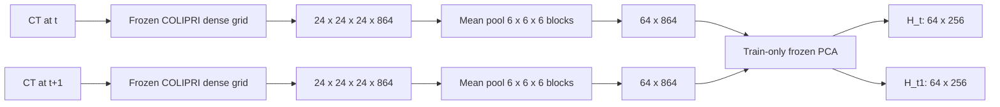
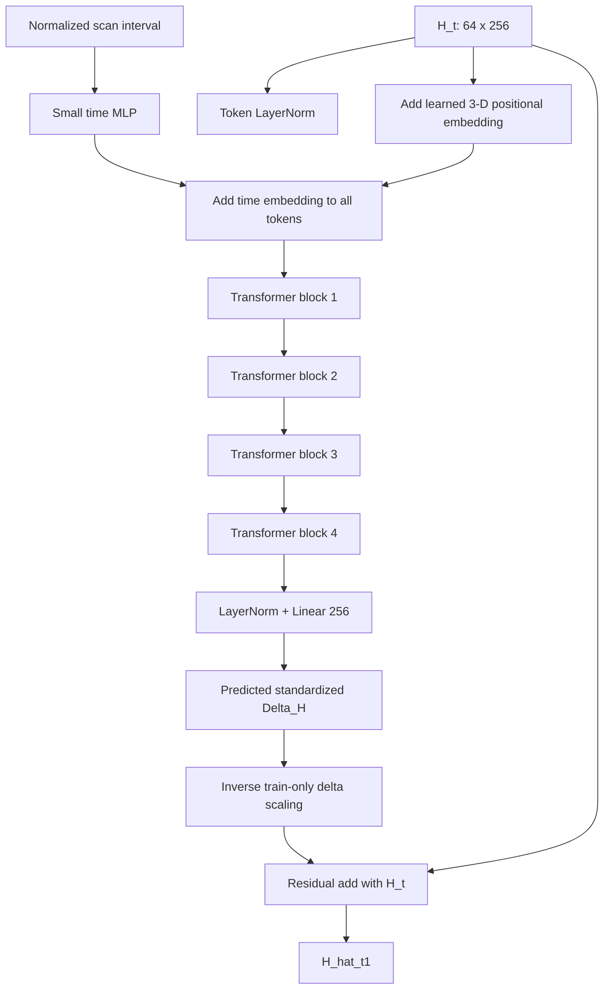

# COLIPRI spatial/token-level world-model experiment

## Executive result

The compact spatial Transformer improves token-space reconstruction over the
spatial identity baseline, but it does **not** recover more prognostic or
diagnostic information than the previous pooled 864-d MLP.

The result is therefore mixed:

- **Latent forecasting:** positive. The Transformer beats token identity in
  MSE, L2, cosine similarity, and delta cosine.
- **Prognosis:** negative relative to the pooled MLP. The predicted spatial
  state is below the previous pooled MLP at all three cancer horizons.
- **Diagnostics:** mixed but mostly negative. Emphysema is preserved well;
  focal isolation/nodule information is below the pooled MLP and far below the
  actual future state.
- **Oracle representation:** the actual spatial `H_t1` state is itself less
  prognostic than the original 864-d mean-pooled COLIPRI `z_t1`. The
  4×4×4 spatial pooling plus 256-D PCA therefore introduces information loss
  before world-model prediction is evaluated.

The main conclusion is that coarse spatial structure alone does not explain the
oracle gap. The current 64-token representation and its global mean-pooled
downstream probe are not yet a better state space for this cohort.

## 1. Experimental setup

The experiment used the existing frozen COLIPRI dense cache:

```text
F_t: [864, 24, 24, 24]
```

Each dense grid was reduced by deterministic 3-D block averaging:

```text
[864, 24, 24, 24] → [64, 864] → PCA → [64, 256]
```

The PCA was fitted using tokens from training patients only and then frozen for
all validation and test scans. Token deltas were standardized feature-wise on
training pairs only.



The model was a four-block Transformer encoder with 256-dimensional tokens,
four heads, feed-forward width 1024, dropout 0.1, learned 3-D-grid positional
embeddings, and a small time embedding added to every token. It predicted a
standardized token residual:

```text
Delta_H       = H_t1 - H_t
Delta_H_norm  = train-standardized(Delta_H)
Delta_H_hat   = Transformer(H_t, Δt)
H_hat_t1      = H_t + inverse_scale(Delta_H_hat)
```



## 2. Data and seeds

- 1,984 pairs: 995 T0→T1 and 989 T1→T2.
- Same patient-level 599/200/200 train/validation/test split.
- Five independent world-model seeds.
- Five downstream linear-probe seeds.
- No cancer or diagnostic labels were used to train the world model.
- W&B project: `nlst-colipri-latent-world-model`, group
  `spatial-token-world-model`.

## 3. Latent forecasting

Metrics are evaluated in the `[64,256]` token space on test pairs. The
Transformer values below are means across five world-model seeds.

### Pooled pairs

| Representation | MSE ↓ | Cosine ↑ | L2 ↓ | Delta MSE ↓ | Delta cosine ↑ |
|---|---:|---:|---:|---:|---:|
| Identity `H_t` | 0.006327 | 0.859567 | 9.8049 | 0.006327 | 0.000 |
| Spatial Transformer | **0.005576** | **0.869971** | **9.2583** | **0.005576** | **0.3475** |
| Actual `H_t1` oracle | 0 | 1 | 0 | 0 | 1 |

The Transformer improves token forecasting by approximately 12% in MSE and 6%
in L2 relative to identity, while also increasing cosine similarity. This is
stronger than the first pooled raw-residual baseline, which did not beat its
identity predictor in MSE/L2.

### Transition-specific results

| Scope | Identity MSE | Transformer MSE | Identity L2 | Transformer L2 |
|---|---:|---:|---:|---:|
| T0→T1 | 0.006234 | **0.005395** | 9.7794 | **9.1715** |
| T1→T2 | 0.006421 | **0.005758** | 9.8305 | **9.3590** |

The improvement is present in both transition types and is slightly stronger
for T0→T1. T1→T2 remains the harder transition.

## 4. Prognostic evaluation

For downstream probing, the 64 predicted tokens were mean-pooled into a global
256-d state. All representations were evaluated against the same primary
post-t+1 cancer labels.

### Pooled test pairs

| Horizon | Current `H_t` AUROC | Predicted spatial AUROC | Actual `H_t1` AUROC | Current AUPRC | Predicted AUPRC | Actual AUPRC |
|---|---:|---:|---:|---:|---:|---:|
| 1y | 0.578 | 0.590 | **0.795** | 0.132 | 0.160 | **0.520** |
| 2y | 0.561 | 0.578 | **0.663** | 0.243 | 0.262 | **0.429** |
| 3y | 0.601 | 0.618 | **0.636** | 0.395 | 0.424 | **0.467** |

The predicted spatial state is directionally better than current `H_t`, but
the gain is small and it remains far below actual `H_t1`.

The comparison with the previous pooled MLP is especially important:

| Horizon | Previous pooled MLP AUROC | Spatial Transformer AUROC |
|---|---:|---:|
| 1y | ~0.717 | 0.590 |
| 2y | ~0.667 | 0.578 |
| 3y | ~0.654 | 0.618 |

Thus the spatial Transformer does not recover more prognostic information than
the pooled MLP, despite better token-space reconstruction.

### T0→T1 and T1→T2

The same pattern holds by transition type:

- T0→T1: spatial prediction is only marginally above current `H_t`, with
  very unstable 1y cancer results because of the small transition-specific
  test set.
- T1→T2: spatial prediction improves over current `H_t` at 2y and 3y and is
  close at 1y, but remains well below actual `H_t1`.
- Actual `H_t1` has a large short-horizon advantage for T1→T2, showing that
  the spatial representation still retains future signal that the predictor
  cannot recover from `H_t`.

## 5. Strict t+1 diagnostic evaluation

All representations were evaluated against the same t+1 diagnostic labels.
The table reports pooled AUROC/AUPRC means over probe seeds.

| Target | Current `H_t` AUROC | Predicted spatial AUROC | Actual `H_t1` AUROC | Current AUPRC | Predicted AUPRC | Actual AUPRC |
|---|---:|---:|---:|---:|---:|---:|
| isolation_suspicious | 0.680 | 0.679 | **0.768** | 0.576 | 0.567 | **0.683** |
| nodule_ge_4mm | 0.671 | 0.670 | **0.766** | 0.569 | 0.566 | **0.680** |
| emphysema | 0.751 | 0.758 | **0.771** | 0.695 | **0.704** | 0.689 |
| fibrosis_or_scarring | 0.599 | 0.614 | **0.642** | 0.416 | 0.433 | **0.442** |

The spatial predictor does not recover focal diagnostic information for
isolation or nodules. It is close to the actual future representation for
emphysema and improves fibrosis/scarring over the current state, but these are
not enough to compensate for the loss on focal targets.

## 6. Interpretation

### What worked

The token Transformer learned a meaningful transition. It beats identity in
every latent metric, including MSE and L2, and it predicts a delta with
non-zero alignment to the true token delta.

This confirms that preserving coarse spatial structure can improve the
forecasting objective itself.

### What did not work

The improved token reconstruction did not translate into a better prognostic
state than the pooled MLP. In fact, the pooled MLP remains substantially
better for the short-horizon cancer endpoints.

The main likely reason is representational rather than Transformer capacity:

1. The original COLIPRI mean-pooled 864-d representation has much stronger
   diagnostic/prognostic decodability than the PCA-reduced 256-d mean of the
   64 tokens.
2. The downstream probe collapses the predicted spatial tokens back to a mean,
   discarding precisely the spatial information the Transformer was designed
   to preserve.
3. The model is trained only with token MSE, so it has no pressure to preserve
   sparse, focal, diagnosis-adjacent features that matter for short-term
   prognosis.

The actual `H_t1` oracle is itself weaker than the original actual 864-d
`z_t1` oracle. This makes the comparison fair within the spatial experiment,
but it also shows that the 4×4×4 pooling plus 256-D PCA is not a neutral
representation change.

## 7. Answer to the scientific question

**Does the spatial/token world model recover more of the prognostic and
diagnostic advantage of actual future state than the pooled 864-d MLP?**

No, not in this first formulation.

It recovers more of the *latent reconstruction* advantage than the pooled MLP,
but not more of the clinically relevant future-state information. The pooled
MLP remains the stronger prognostic representation, while the spatial model
offers useful evidence that a coarse token transition can be learned.

## 8. Recommended next steps

1. **Do not increase Transformer size yet.** The limiting issue appears to be
   the representation/objective rather than insufficient attention capacity.
2. **Preserve the original 864-d global state.** Add a global pooled residual
   head or concatenate the original mean-pooled 864-d state with the spatial
   token summary before probing.
3. **Avoid mean-pooling tokens for the final probe.** Test attention pooling,
   learned gated pooling, or a fixed spatially weighted pooling so focal token
   information is not discarded.
4. **Run a PCA ablation.** Compare 256-D PCA with 512-D PCA and no PCA on a
   smaller token subset. The current oracle drop suggests 256 components may
   be too aggressive.
5. **Use a joint global-plus-token objective.** Keep standardized token MSE,
   but add a small loss on the original 864-d mean-pooled future embedding.
   This retains the strong global prognostic state while training spatial
   dynamics.
6. **Add a focal-aware auxiliary objective only after a clean baseline.** A
   training-only diagnostic direction loss could test whether sparse future
   changes are predictable, without changing COLIPRI.
7. **Use paired patient-level bootstrap intervals.** The observed gains are
   small and transition-specific test sets are limited.

## 9. Artifacts

- Runner: `scripts/run_colipri_spatial_token_world_model.py`
- Cached spatial tokens: `cached_spatial_tokens.npy`
- Train-only PCA: `token_pca.npz`
- Delta/time scalers: `delta_scaler.npz`, `time_scaler.npz`
- Checkpoints: `checkpoints/seed*/best.ckpt`
- Predictions: `predictions/seed*.npy`
- Latent metrics: `latent_per_seed_metrics.csv`
- Downstream metrics: `downstream_per_seed_metrics.csv`
- W&B runs: `wandb/`

