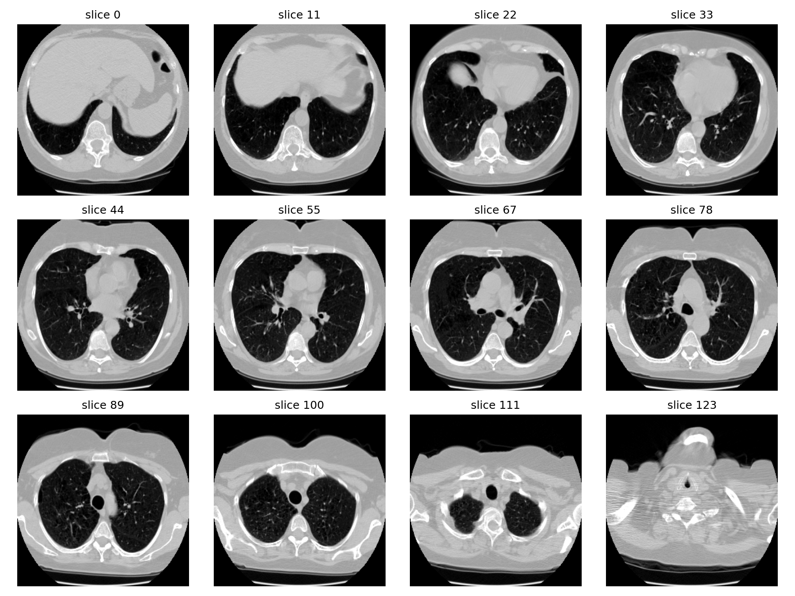

# NLST pilot 1000: dataset e preprocessing

## Scopo

Questo report descrive il cohort pilota usato per gli esperimenti longitudinali
con RadJEPA-3D e la pipeline che prepara i volumi per l'estrazione di sliding
window lungo l'asse z.

## Dataset

Il cohort è identificato dal tag `pilot_1000_balanced` e usa i DICOM NLST
presenti in `data/nlst/raw/nlst/dicom` (il percorso locale è un symlink al
dataset sul server).

| Proprietà | Valore |
|---|---:|
| Pazienti | 1000 |
| `cancer_label=0` | 500 |
| `cancer_label=1` | 500 |
| Screening per paziente | 3 per tutti |
| Serie CT | 3000 |
| Transizioni longitudinali | 2000 |
| Seed di selezione | 42 |

La selezione è bilanciata per `cancer_label` e privilegia pazienti con tre
screening. Ogni paziente contribuisce quindi con T0, T1 e T2; le transizioni
sono T0→T1 e T1→T2.

Manifest principali:

- `data/nlst/manifests/nlst_pilot_1000_balanced_subjects.csv`
- `data/nlst/manifests/nlst_pilot_1000_balanced_series.csv`
- `data/nlst/manifests/nlst_pilot_1000_balanced_pairs.csv`

I DICOM raw sono conservati. I NIfTI e i volumi derivati dei pilot precedenti
sono stati rimossi; gli array del nuovo preprocessing vengono scritti sotto
`data/nlst/processed/nlst/pilot_1000_balanced/sliding_npy/` quando il job viene
eseguito sul server.

## Pipeline DICOM → NPY

La pipeline è implementata in
`scripts/prepare_radjepa_sliding_volume.py`.

### 1. Lettura e selezione delle slice

Per ogni serie indicata dal manifest:

1. vengono letti i DICOM con `PixelData`;
2. sono rimossi localizer, scout, topogrammi e immagini simili;
3. vengono mantenute le immagini con la shape dominante;
4. le slice sono ordinate tramite `ImagePositionPatient` e
   `ImageOrientationPatient`;
5. le posizioni duplicate sono rimosse solo quando i pixel HU coincidono;
6. sono controllati numero minimo di slice, copertura anatomica e grandi gap
   geometrici.

### 2. Conversione in HU

Ogni immagine viene convertita usando i metadati DICOM:

```text
HU = pixel_array * RescaleSlope + RescaleIntercept
```

Il volume viene poi trasposto da `(H, W, D)` a `(D, H, W)`, cioè con la
profondità lungo il primo asse.

### 3. Crop foreground

Il foreground è definito dai voxel sopra `-500 HU`, con un margine di 8 pixel.
Il crop è robusto ai pixel isolati e agli artefatti del tavolo tramite
percentili sulle coordinate spaziali. La profondità z non viene ridotta in
base alla shape: resta disponibile per coprire l'intera serie con finestre
sovrapposte.

### 4. Resize in-plane

Viene applicato un resize lineare esclusivamente a `H` e `W`:

```text
(D, H, W) → (D, 256, 256)
```

Non viene effettuato alcun ricampionamento a spacing fisico uniforme lungo z.
La profondità nativa è intenzionalmente conservata per non diluire i noduli.

### 5. Intensità

La modalità usata per RadJEPA è la finestra polmonare fissa:

```text
clip(HU, -1000, 400)
normalized = (HU + 1000) / 1400
```

Il risultato è `float32` nell'intervallo `[0, 1]`. La normalizzazione è
applicata al volume prima di estrarre le sliding window, così tutte le finestre
della stessa CT condividono la stessa scala di intensità.

### 6. Output

Ogni serie produce un file:

```text
(1, D, 256, 256)  float32
```

Il canale iniziale è quello richiesto dal checkpoint RadJEPA-3D. La dimensione
`D` varia tra le serie; successivamente si estraggono finestre da 32 slice,
tipicamente con stride 8 o 16, aggiungendo padding ai bordi quando necessario.

Il manifest del preprocessing registra shape, bounds del crop, normalizzazione,
serie DICOM e percorso dell'NPY.

## Controllo visivo

La figura mostra 12 slice del primo campione elaborato, paziente `100082`,
timepoint `T0`. Il volume risultante ha shape `(1, 124, 256, 256)`. Con la
finestra HU, l'aria polmonare è scura, i tessuti molli sono grigi e l'osso è
chiaro.



## Comando di esecuzione

```bash
nohup .venv/bin/python scripts/prepare_radjepa_sliding_volume.py \
  --manifest /ssd2/domenico/datasets/nlst/manifests/nlst_pilot_1000_balanced_series.csv \
  --dicom-root /ssd2/domenico/datasets/nlst/raw/nlst/dicom \
  --output-root /ssd2/domenico/datasets/nlst/processed/nlst/pilot_1000_balanced/sliding_npy \
  --output-manifest /ssd2/domenico/datasets/nlst/processed/nlst/pilot_1000_balanced/sliding_npy_manifest.csv \
  --normalization window \
  > /ssd2/domenico/datasets/nlst/processed/nlst/pilot_1000_balanced/sliding_npy.log 2>&1 < /dev/null &
```

