# Messaggio principale

- COLIPRI contiene informazione clinica forte e accessibile con probe semplici.
- Il **futuro reale** è molto più prognostico dello stato corrente, soprattutto a 1–2 anni.
- I world model ricostruiscono una parte del cambiamento, ma recuperano solo una piccola parte del vantaggio prognostico.
- L’evidenza punta verso un limite di **segnale/dati/target**, non verso una semplice mancanza di capacità architetturale.

::: notes
Tempo: 1 minuto. Aprire subito con la conclusione, non con la cronologia. Il progetto ha validato la premessa scientifica — il futuro reale è più informativo — ma non ha ancora dimostrato che tale informazione sia prevedibile dal passato disponibile. Sottolineare che i risultati negativi hanno eliminato diverse spiegazioni semplici.
:::

# Il percorso sperimentale

1. Costruire una coorte longitudinale affidabile e label landmark-safe.
2. Verificare quali foundation model producono stati clinicamente decodificabili.
3. Misurare l’upper bound: presente osservato vs futuro osservato.
4. Predire il futuro latente con modelli piccoli e controllati.
5. Separare ricostruzione, conservazione dell’informazione e valore della storia.

::: notes
Tempo: 1 minuto. Questa slide è la mappa della presentazione. Evidenziare che ogni fase risponde a una domanda diversa: prima se la rappresentazione è buona, poi se il futuro aggiunge informazione, infine se questa informazione è prevedibile.
:::

# Dataset: coorte NLST selezionata

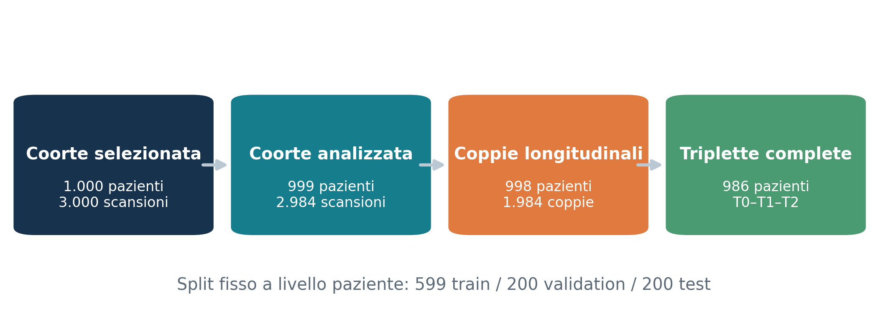{width=95%}

::: notes
Tempo: 2 minuti. Distinguere i quattro livelli: 1.000 pazienti nominali; 999/2.984 scansioni realmente analizzate; 998/1.984 coppie utilizzabili; 986 triplette complete per gli esperimenti T0–T1–T2. Un paziente può contribuire due coppie, ma rimane sempre nello stesso split.
:::

# Costruzione dei dati e controllo del leakage

- Split fisso a livello paziente: **599 / 200 / 200**.
- Tutte le normalizzazioni, PCA e statistiche dei delta sono fit solo sul train.
- Stesse coppie e stessi pazienti per i confronti fra rappresentazioni.
- Encoder congelati; checkpoint selezionati solo su validation.
- Il test è già stato ispezionato: non è validazione esterna.

::: notes
Tempo: 1 minuto. Specificare che la separazione per paziente impedisce che T0 di un soggetto finisca nel train e T1 nel test. Il punto sul test già osservato è importante: i confronti sono solidi come analisi di sviluppo, ma non supportano ancora claim clinici.
:::

# Label diagnostiche: stato osservato nella scansione

Derivate dai metadati NLST di lettura radiologica e anomalie CT:

- `isolation_suspicious` — prevalenza 39,0%
- `nodule_ge_4mm` — 38,8%
- `emphysema` — 41,5%
- `fibrosis_or_scarring` — 25,1%

Validazione dello stato congelato e recupero futuro contro la **stessa label t+1**.

::: notes
Tempo: 1,5 minuti. Le label non sono segmentazioni voxel-level: sono etichette cliniche/read-level. Per questo misurano decodificabilità dello stato globale, non localizzazione. Ricordare che il confronto stretto t+1 evita di favorire lo stato corrente con la sua label contemporanea.
:::

# Label prognostiche: landmark dopo la scansione

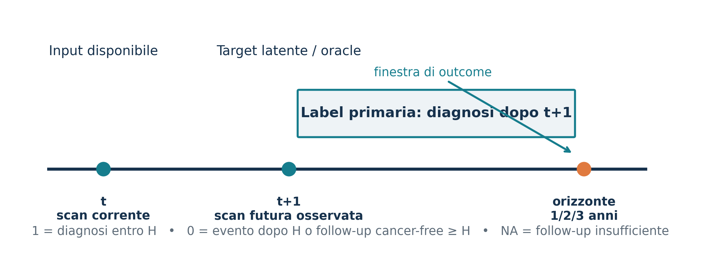{width=94%}

::: notes
Tempo: 2 minuti. Spiegare la regola: 1 se la diagnosi cade entro 365/730/1.095 giorni; 0 solo se osserviamo un evento più tardi o follow-up cancer-free sufficiente; NA se il follow-up non copre l’orizzonte. Le diagnosi già avvenute al landmark sono escluse. Non sono disponibili endpoint di mortalità nei dati locali IDC.
:::

# Distribuzione delle classi: il nodo temporale

| Endpoint post-t+1 | Train | Validation | Test |
|---|---:|---:|---:|
| 1 anno | 107 / 1.186 (9,0%) | 33 / 394 (8,4%) | 31 / 396 (7,8%) |
| 2 anni | 256 / 1.181 (21,7%) | 81 / 391 (20,7%) | 75 / 396 (18,9%) |
| 3 anni | 364 / 1.173 (31,0%) | 112 / 389 (28,8%) | 113 / 396 (28,5%) |

::: notes
Tempo: 2 minuti. Questa è una delle slide più importanti. Il pooled 1-year task può sfruttare il tipo di transizione. Non significa che le label siano sbagliate; significa che la selezione della coorte e la storia naturale generano una forte differenza tra round. Per questo abbiamo introdotto analisi stratificate e la coorte a triplette, una riga per paziente.
:::

# Foundation model esplorati

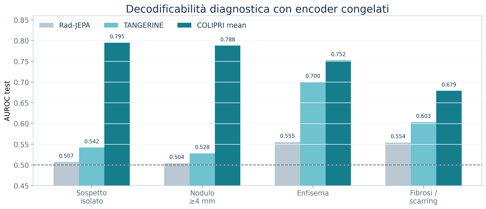{width=93%}

::: notes
Tempo: 2 minuti. Presentare questa come la selezione dello “state space”. Rad-JEPA non decodifica noduli/sospetto; TANGERINE migliora soprattutto enfisema; COLIPRI è nettamente più forte e più uniforme. Le differenze includono anche i preprocessing nativi dei modelli, quindi non sono un confronto architetturale puro.
:::

# Rad-JEPA-3D: primo baseline

- Input a finestre 3D da 32 slice; feature token da 384 dimensioni.
- Aggregazioni: resize, sliding mean/max/mean-max, gated attention.
- 100 run complessivi, split e scaling train-only.
- Risultato: sospetto e nodulo ≈ chance; segnale debole per enfisema e fibrosi.
- Migliori AUROC: **0,508 / 0,506 / 0,555 / 0,564**.

::: notes
Tempo: 1,5 minuti. Il risultato negativo ha mostrato che non bastava cambiare aggregazione. La gated attention non ha creato un vantaggio generale. Questo ha motivato il passaggio a foundation model whole-volume più forti.
:::

# TANGERINE: salto parziale

- ViT-L, volume 256³, 4.096 patch token, embedding globale 2.048-d.
- Miglioramento netto per enfisema: AUROC **0,700**.
- Miglioramento moderato per fibrosi: **0,603**.
- Sospetto e nodulo restano deboli: **0,542 / 0,528**.
- MLP downstream non migliore del probe lineare.
- Caveat: pretraining NLST-LSS; overlap esatto ignoto.

::: notes
Tempo: 1,5 minuti. Il risultato dice che TANGERINE cattura fenotipi diffusi come l’enfisema, ma il global embedding non basta per i target focali. L’overlap di pretraining impedisce di chiamare il test NLST una validazione indipendente.
:::

# Perché abbiamo scelto COLIPRI

- Dense feature grid nativa: `[24,24,24,864]`.
- Preprocessing ufficiale: RAS, 2 mm isotropico, crop/pad 192³.
- Mean pooling 864-d è il miglior aggregatore diagnostico.
- AUROC: sospetto **0,795**, nodulo **0,788**, enfisema **0,752**, fibrosi **0,679**.
- Offre sia uno stato globale compatto sia token spaziali per esperimenti successivi.

::: notes
Tempo: 1 minuto. COLIPRI non è stato scelto perché “ricostruisce meglio”, ma perché il suo spazio è clinicamente decodificabile con una testa molto semplice. Anche COLIPRI ha usato immagini NLST nel pretraining MAE; l’overlap esatto non è documentato.
:::

# Come è costruita la rappresentazione del volume

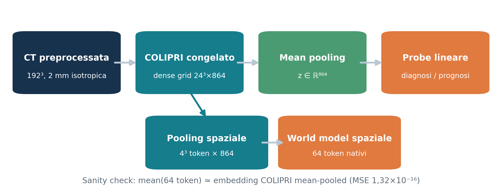{width=95%}

::: notes
Tempo: 2 minuti. Rispondere esplicitamente alla domanda ricorrente sull’aggregazione. La griglia 24³ viene mediata per ottenere z 864-d. Per il modello spaziale la stessa griglia è ridotta a 4³ blocchi, quindi 64 token da 864 dimensioni. La media dei 64 token ricostruisce numericamente lo stesso z globale.
:::

# Esperimento chiave: il futuro reale è più prognostico?

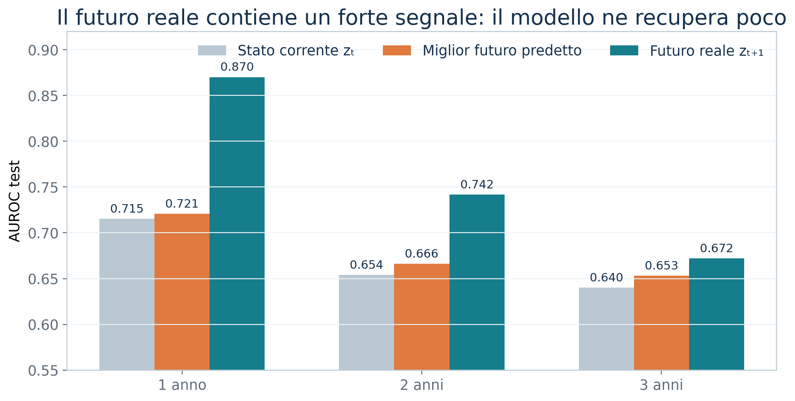{width=90%}

::: notes
Tempo: 2 minuti. Questo è il “north star”. A 1 anno il passaggio dal presente al futuro reale vale circa +0,155 AUROC; a 2 anni +0,088; a 3 anni +0,032. Il vantaggio diminuisce con l’orizzonte, coerentemente con un segnale diagnosis-adjacent. Il futuro reale non è un modello utilizzabile: è l’upper bound osservato.
:::

# Domanda del world model

> Possiamo trasformare lo stato corrente in uno stato futuro predetto che sia più prognostico, senza usare label cliniche nel training della transizione?

Confronto primario:

`zₜ  →  ẑₜ₊₁  →  zₜ₊₁ reale`

- forecasting latente: MSE, cosine, L2, delta cosine;
- prognosi: AUROC, AUPRC, MCC, F1 a 1/2/3 anni;
- diagnosi futura: quattro target contro le stesse label t+1.

::: notes
Tempo: 1 minuto. Sottolineare la separazione: il world model non vede il cancro; dopo il training viene congelato e valutato con lo stesso probe. Questa scelta testa se l’informazione prognostica emerge dalla previsione del futuro, non dalla supervisione outcome-driven.
:::

# Prima architettura: residual MLP

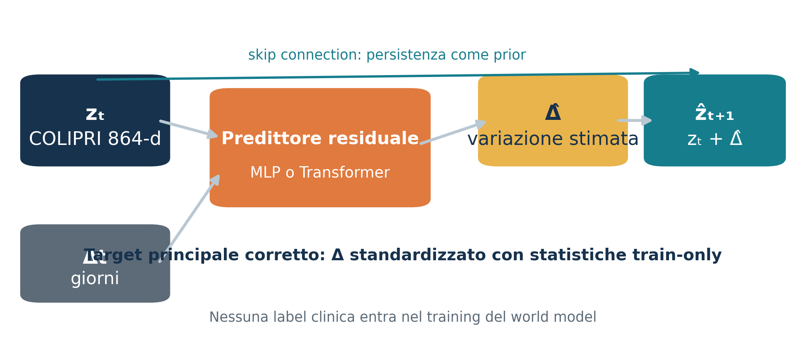{width=94%}

::: notes
Tempo: 2 minuti. L’identità è un baseline molto forte perché le scansioni sono simili. Il modello predice un delta e usa una skip connection. La prima versione ottimizzava MSE raw + cosine sul futuro; la versione corretta predice il delta standardizzato feature-wise.
:::

# Ablation dell’obiettivo: cosa è migliorato

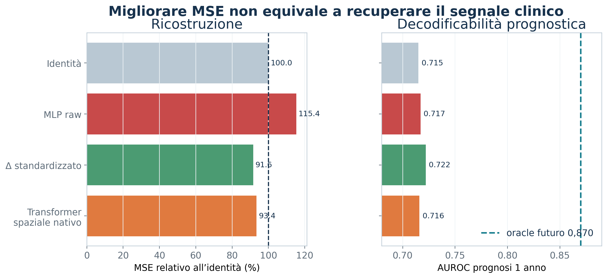{width=96%}

::: notes
Tempo: 2 minuti. Il target scaling era davvero un problema: finalmente il modello batte la persistenza in MSE. Ma l’AUROC a 1 anno passa solo da circa 0,715 a 0,722, ancora lontano da 0,870. Cosine aggiuntivo e residual shrinkage non hanno cambiato materialmente il risultato. Questo separa chiaramente “prevedere la media del futuro” da “prevedere la parte clinicamente utile”.
:::

# Modelli spaziali: PCA-256 vs spazio nativo

- Dense grid → mean pooling spaziale → 64 token.
- PCA-256: ricostruzione migliore, ma oracle clinico indebolito.
- Nativo 864-d: 3 blocchi, 8 head, senza PCA.
- Il modello nativo riduce la token-MSE del **6,6%** vs identità, ma la prognosi resta ≈ MLP pooled.
- AUROC 1y/2y/3y: pooled MLP **0,717/0,667/0,654**; nativo **0,716/0,668/0,652**.

::: notes
Tempo: 2 minuti. PCA era un bottleneck reale, perché indeboliva persino il futuro osservato. Rimuoverla ripristina lo spazio COLIPRI e migliora i target focali, ma non crea un vantaggio prognostico. Il problema non sembra quindi “manca un Transformer”: con circa 2.000 coppie, più capacità rischierebbe solo overfitting.
:::

# Diagnostica futura stretta

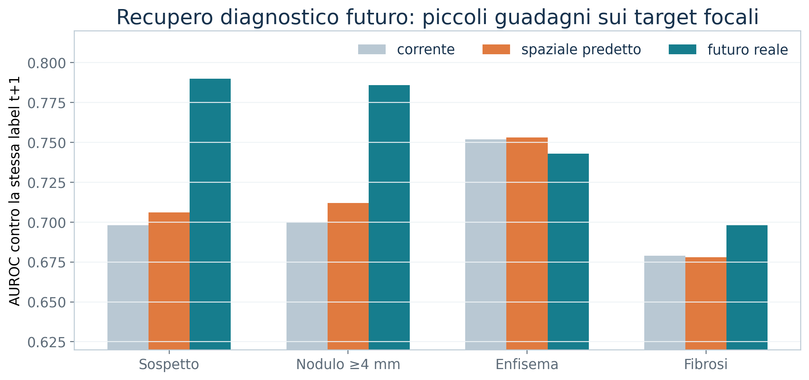{width=92%}

::: notes
Tempo: 1,5 minuti. Tutte le barre usano le label del futuro t+1. Il modello nativo passa da 0,698 a 0,706 sul sospetto e da 0,700 a 0,712 sul nodulo, mentre gli oracle sono 0,790 e 0,786. È un segnale coerente ma piccolo: preservare spazio aiuta, tuttavia la transizione non sa prevedere la nuova informazione focale.
:::

# Adapter temporali: risultato e audit del codice

- Adapter iniziale: `864 → 256 → 128`, predictor residuale nel latent space.
- Ricostruzione interna molto buona, prognosi inizialmente ≈ chance.
- Audit: export di training mescolato, label in ordine manifest → **risultati downstream iniziali invalidi**.
- Rivalutazione corretta: bottleneck ancora debole, ma non catastrofico.
- Tutti i 30 checkpoint originali avevano **SIGReg disabilitato**.

::: notes
Tempo: 2 minuti. Essere molto trasparenti: non mostrare le AUROC vicine a 0,5 come risultato scientifico, perché erano prodotte dal bug. Dopo la correzione, il bottleneck compatto resta meno prognostico del nativo. La ragione plausibile è che MSE privilegia direzioni ad alta varianza, mentre il segnale prognostico può vivere in componenti piccole.
:::

# Adapter di preservazione e SIGReg

- Adapter residuale 864-d inizializzato all’identità.
- Due fasi: preservazione, poi transizione con adapter congelato.
- Bottleneck 256/512 e SIGReg con probe matched.
- Il residuale preserva quasi esattamente la prognosi corrente.
- SIGReg non produce un guadagno stabile; i bottleneck perdono o non aggiungono informazione.

::: notes
Tempo: 1,5 minuti. Questo esperimento risponde alla domanda “l’adapter sta distruggendo informazione?”. Con il percorso residuale, no: la conserva. Ma conservarla non basta a prevedere il vantaggio del futuro. SIGReg può regolarizzare la distribuzione, non inventare il segnale oncologico assente nel passato.
:::

# Supervisione prognostica sull’adapter

- Adapter residuale 864-d con BCE 1/2/3 anni + ricostruzione + anchor.
- Nessun futuro, delta o round negli input.
- Test pooled, probe congelato:
  - COLIPRI corrente: **0,715 / 0,654 / 0,640**
  - adapter joint: **0,713 / 0,654 / 0,641**
- La testa lineare diretta resta competitiva; nessun vantaggio robusto.

**Interpretazione:** il limite non si risolve con una piccola deformazione supervisionata dello stesso stato corrente.

::: notes
Tempo: 1,5 minuti. La supervisione prognostica era una prova controllata, non il world model finale. Il risultato indica che, con questa numerosità e questi endpoint, un adapter residuale tende a restare vicino all’identità. L’MLP senza skip generalizza peggio. Ricordare il baseline round-only, soprattutto a 1 anno.
:::

# La storia osservata aiuta davvero?

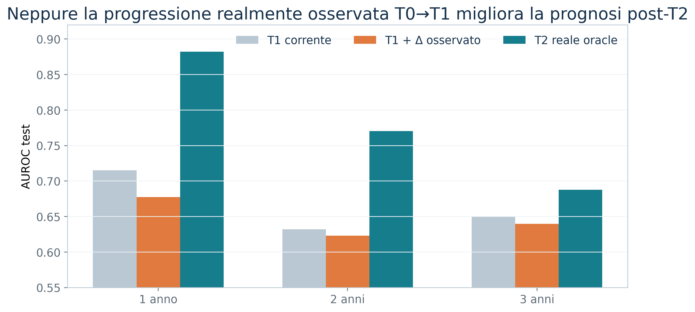{width=91%}

::: notes
Tempo: 2 minuti. Questo esperimento rimuove l’incertezza del world model: usiamo il delta reale T1−T0 e chiediamo se aiuta a prevedere dopo T2. Né il modello globale gated né quello spaziale capacity-matched migliorano il controllo current-only. Nel modello spaziale, il delta reale è persino significativamente peggiore a 3 anni nel bootstrap. Quindi il passato cambiamento non è automaticamente una proxy del prossimo cambiamento oncologico.
:::

# Audit di allineamento dei token

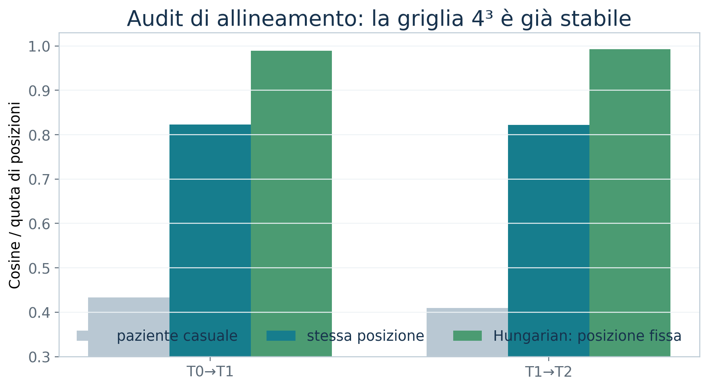{width=84%}

::: notes
Tempo: 1,5 minuti. L’ipotesi era che sottraessimo token anatomicamente non corrispondenti. L’audit su tutte le 1.984 coppie non la supporta: la griglia 4×4×4 è fortemente stabile. Questo non prova registrazione voxel-perfect, ma rende improbabile che un semplice shift della griglia sia il collo di bottiglia dominante.
:::

# Cosa abbiamo imparato

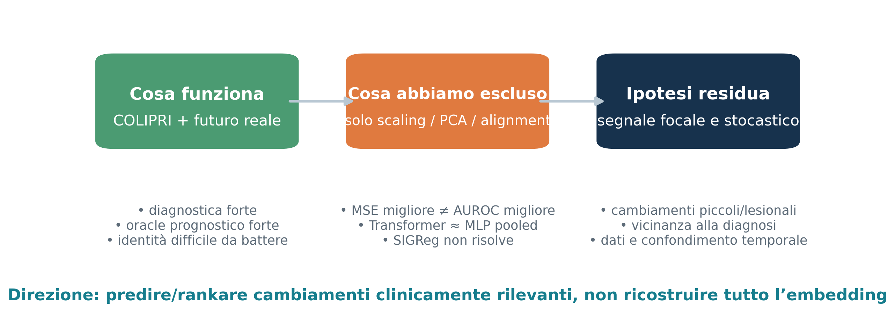{width=96%}

::: notes
Tempo: 2 minuti. Sintesi causale prudente. Sappiamo che COLIPRI vede lo stato clinico e che il futuro reale è prognostico. Sappiamo anche che scaling, PCA, adapter e allineamento non spiegano da soli il gap. L’ipotesi più coerente è che il segnale futuro sia in parte nuovo, focale, piccolo rispetto alla variabilità totale e vicino alla diagnosi.
:::

# Direzione più promettente

1. **Riformulare il target clinico-temporale**
   - landmark a T1 con outcome dopo T1; lag minimo dalla diagnosi;
   - coorte non pooled per round o sampling bilanciato per transizione.
2. **Rappresentazione locale/lesion-aware**
   - token a risoluzione più fine, candidate region/nodule tokens;
   - global state + top-k cambiamenti focali.
3. **Obiettivo discriminativo controllato**
   - contrastive/ranking su progressori vs non-progressori;
   - preservazione diagnostica/prognostica solo su train, con oracle gap monitorato.
4. **Validazione indipendente** prima di aumentare la scala del modello.

::: notes
Tempo: 2 minuti. La proposta non è passare subito a un Transformer più grande. Prima occorre rendere prevedibile il target: ridurre il confondimento del round, separare segnali diagnosis-adjacent e focalizzare la rappresentazione sulle regioni che cambiano. Una loss clinica può aiutare, ma va trattata come supervised risk modeling e validata senza contaminare il test.
:::

# Prossimo esperimento minimo e informativo

**Studio lesion-aware con controllo matched**

- Input: COLIPRI globale + token locali ad alta risoluzione da T0/T1.
- Target: rischio post-T1, con esclusione/stratificazione per diagnosi entro 90–180 giorni.
- Modelli: current-only vs current+storia, stessa capacità.
- Nessuna previsione completa dell’embedding nella prima fase.
- Output: AUROC/AUPRC, bootstrap per paziente, performance per round e lag.

Decisione richiesta: investire prima nel **target e nella localizzazione**, non nella profondità del world model.

::: notes
Tempo: 1,5 minuti. Chiudere con una proposta operativa. Il test più informativo è chiedere se una storia locale reale contiene segnale, usando endpoint meno contaminati dalla diagnosi imminente. Solo se questo è positivo ha senso addestrare un world model locale a predire quelle componenti.
:::

# Limiti da mantenere visibili

- Coorte case-control arricchita; probabilità non interpretabili come rischio assoluto.
- Test riutilizzato durante lo sviluppo; risultati non esterni.
- Possibile overlap NLST con il pretraining di TANGERINE/COLIPRI.
- Label read-level; ~2.000 coppie e solo 2 positivi T0→T1 nel test 1y.
- Differenze spesso piccole rispetto all’incertezza campionaria.

::: notes
Tempo: 1 minuto. Questa slide protegge l’interpretazione. Le seed SD misurano variabilità di ottimizzazione, non incertezza sui pazienti. Per i claim futuri servono bootstrap paired e una coorte esterna non utilizzata nello sviluppo.
:::

# Conclusione

> Abbiamo trovato un buon spazio clinico e un forte oracle futuro; non abbiamo ancora trovato una dinamica prevedibile che trasferisca quel vantaggio al presente.

- La persistenza è un baseline difficile da battere.
- Il delta medio è prevedibile, il delta prognostico molto meno.
- Più capacità non è ancora la risposta supportata dai dati.
- Prossimo salto: **localizzazione, endpoint e segnale clinicamente mirato**.

::: notes
Tempo: 1 minuto. Frase finale: “Il risultato più utile è sapere dove non investire: non aumenterei la profondità del Transformer finché non dimostriamo che il cambiamento locale osservato contiene un segnale prognostico riproducibile.” Aprire la discussione sulle priorità.
:::

# Appendice — riepilogo numerico

| Esperimento | Risultato principale |
|---|---|
| COLIPRI diagnostica | AUROC 0,795 / 0,788 / 0,752 / 0,679 |
| Futuro reale vs corrente | 1y: 0,870 vs 0,715; 2y: 0,742 vs 0,654 |
| Delta standardizzato | MSE −8,4% vs identità; AUROC +0,005/+0,012/+0,013 |
| Transformer spaziale nativo | token-MSE −6,6%; prognosi ≈ pooled MLP |
| Adapter residuale/SIGReg | preserva, non migliora stabilmente |
| Storia T0→T1 osservata | nessun vantaggio vs current-only |
| Audit allineamento | forte corrispondenza; non è il bottleneck |

::: notes
Slide di backup. I numeri del delta standardizzato usano il protocollo storico dell’ablation; i valori canonici current/future nella presentazione usano il più recente protocollo matched corretto. Le piccole differenze fra report derivano da dettagli del probe e non cambiano le conclusioni.
:::

# Appendice — tracciabilità e riproducibilità

- PyTorch Lightning, W&B, checkpoint per seed.
- Manifest con patient/pair IDs e fingerprint degli input.
- Predizioni ed embedding esportati per seed, senza media primaria.
- Scaler, PCA e statistiche dei delta salvati e fit train-only.
- Smoke test GPU e controlli di shape/ordine prima dei run completi.
- Report completi in `docs/`; risultati macchina in `outputs/`.

::: notes
Slide di backup. Citare l’audit che ha trovato il bug di allineamento come prova del valore di questi controlli. I risultati principali sono riproducibili dagli artefatti locali e dai run W&B, ma la presentazione non dipende dalla disponibilità live di W&B.
:::

# Appendice — documenti sorgente

- Dataset e label: `docs/nlst_*dataset_report.md`, `docs/nlst_prognostic_labels_report.md`
- Foundation model: `docs/nlst_*decodability_report.md`
- Oracle futuro: `docs/nlst_colipri_future_state_prognosis_report.md`
- World model: `docs/nlst_colipri_*world_model*_report.md`
- Adapter/progressione: `outputs/colipri_*/RESULTS.md`
- Allineamento: `docs/nlst_colipri_token_alignment_audit_report.md`

::: notes
Slide di backup per domande sulla provenienza. Ogni tabella della presentazione deriva da uno di questi report completati; non sono state effettuate nuove analisi statistiche per il deck.
:::
