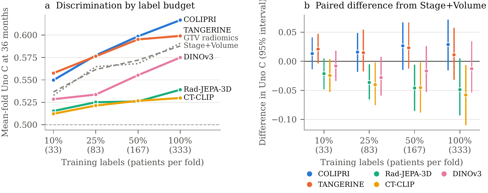
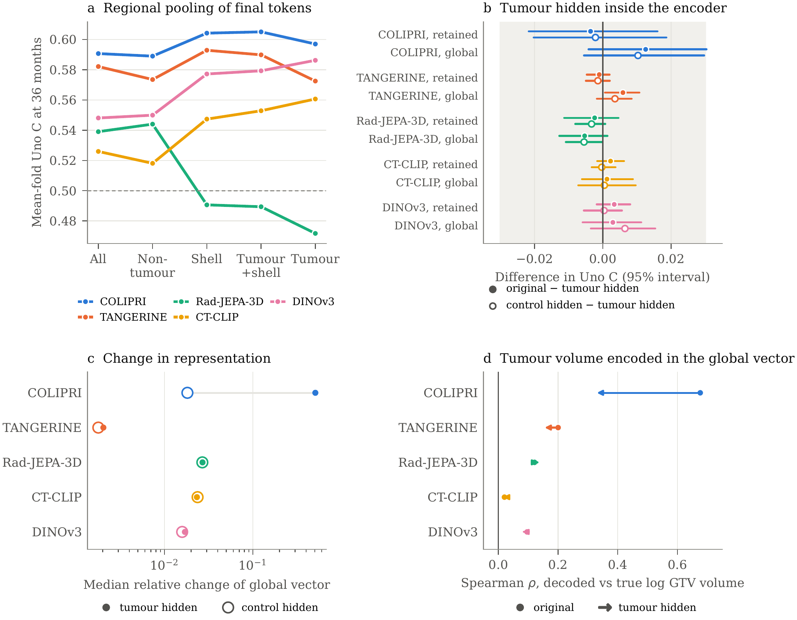
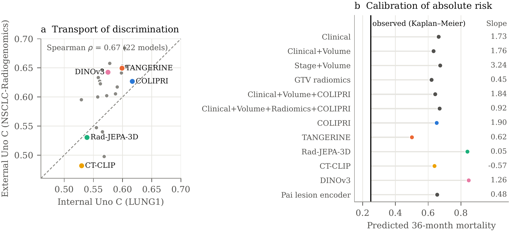

# Results

This gallery reproduces the manuscript figures. Results concern overall-survival prediction from pretreatment CT, with development on 416 LUNG1 patients and external evaluation on 143 NSCLC-Radiogenomics patients. The manuscript remains a working draft.

[Download the aggregate frozen-model results](frozen_model_summary.csv) · [Source hashes](provenance.json) · [Full manuscript results and captions](../../manuscript/sections/results.tex)

The CSV contains all 22 frozen models, including combined clinical models. Internal estimates are mean-fold Uno C at 36 months; external intervals use 2,000 patient resamples and condition on the fitted models. External evaluation had 33 deaths by 36 months. A blank calibration field denotes an unavailable estimate, not zero. Model identifiers follow the analysis scripts: C0 = clinical, C1 = clinical plus volume, C2 = clinical plus volume plus radiomics, C3 = clinical plus volume plus image, C4 = clinical plus volume plus radiomics plus image.

## RQ1 — Frozen representations and clinical value

COLIPRI had the highest internal discrimination (0.617), but no encoder significantly exceeded stage plus volume or radiomics after Holm correction. Adding COLIPRI to clinical covariates plus volume gave a difference of 0.035 (95% interval −0.001 to 0.070), an inconclusive result. PCA32 is a sensitivity analysis; PCA16 is primary.

## RQ2 — Adaptation and training-set size

Trainable heads and encoder adaptation did not improve internal discrimination over the frozen linear head. The encoders did not show an advantage in label efficiency. See the [trainable-model table](../../manuscript/tables/trainable_results.tex) for individual configurations and statistical comparisons.

## RQ3 — Tumour dependence

Masking the tumour changed discrimination by at most 0.013. COLIPRI's representation was sensitive to the tumour, but most prognostic information remained available elsewhere in the scan. Masking comparisons use 403 patients with matched controls; their intervals are not multiplicity-adjusted.

## RQ4 — External evaluation

TANGERINE, DINOv3 and COLIPRI maintained discrimination, while incremental clinical value remained unresolved. Absolute risks were miscalibrated: mean predicted 36-month mortality ranged from 37% to 85% across models, versus 25% observed. The exploratory external LoRA analysis is excluded from the frozen-model CSV; its configuration selection and post hoc timing limit interpretation. See the [external table](../../manuscript/tables/external.tex).

## Regeneration

Run `python3 scripts/build_github_assets.py` from the repository root. This renders the existing manuscript PDFs with Poppler's `pdftoppm` and extracts aggregate metrics from `outputs/phase4_external/external_validation.json`. The local source output is required; patient-level predictions and imaging data are not exported. Source hashes are recorded in `provenance.json`.
